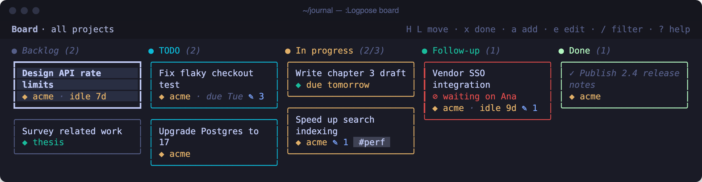
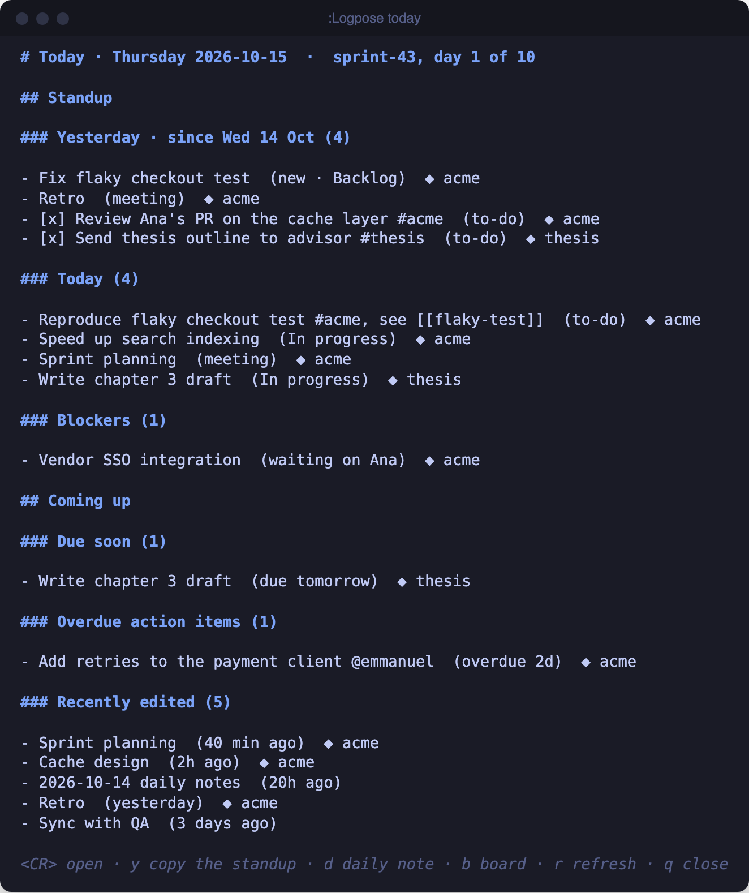
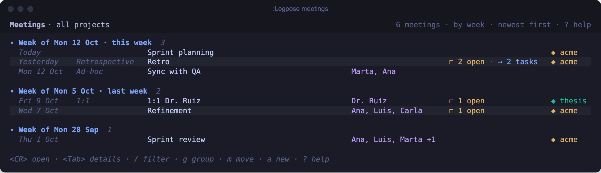
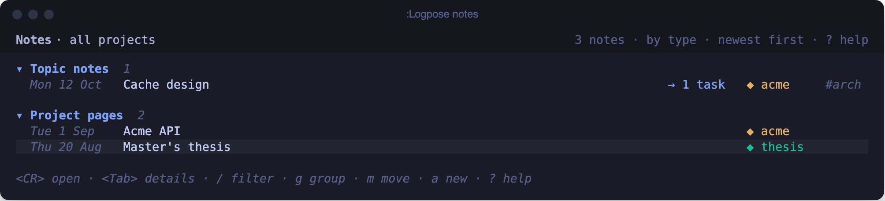
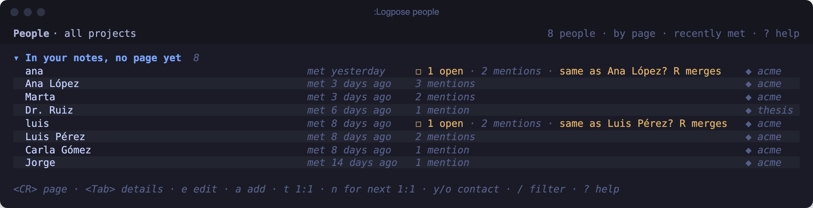
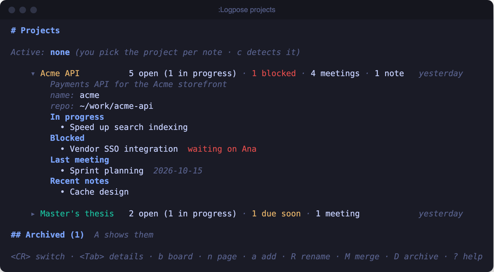
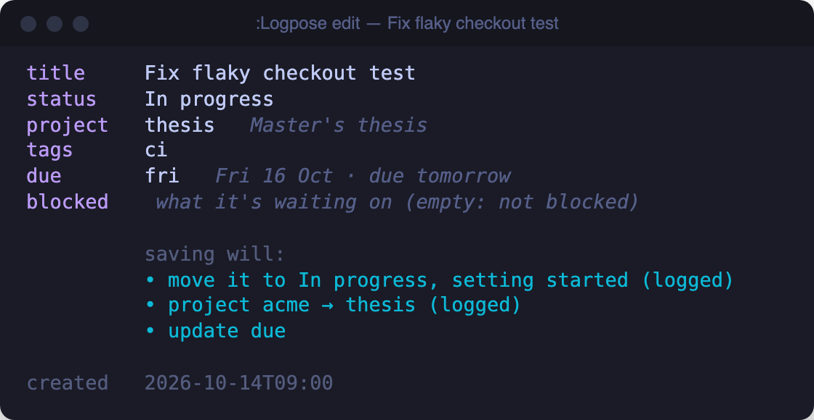

<div align="center">

# logpose.nvim

**A sprint journal in Neovim.**

A standup that writes itself from what you did, meeting notes that remember last time's action
items, and a Kanban board where every task is a markdown file.

[](https://github.com/edieguez/logpose/actions/workflows/ci.yml)
[](https://neovim.io)
[](https://www.lua.org)
[](LICENSE)

[Install](#install) · [Quick start](#quick-start) · [Commands](#commands) ·
[Configuration](#configuration) · [Troubleshooting](#troubleshooting)

</div>



- **Plain markdown, no database.** Everything lives in a folder you choose. logpose reads the
  structure you already write: frontmatter, `## headings`, `#tags`, `@people` and `[[links]]`,
  so the journal reads just as well in Obsidian, on GitHub or with `grep`.
- **Built for Scrum.** It knows your sprints, so the standup, reports, archives and search
  filters work sprint by sprint.
- **Built for juggling projects.** It detects the project from the git repo you're in, and
  keeps meetings, tasks and the board apart per project.
- **Careful with your files.** It never overwrites unsaved changes, writes atomically, and shows
  a preview before it changes many notes at once.

## Contents

| Getting started | Guide | Reference |
|---|---|---|
| [Install](#install) | [Today, standup and daily notes](#today-standup-and-daily-notes) | [Commands](#commands) |
| [Quick start](#quick-start) | [Meetings](#meetings) | [Board keys](#board-keys) |
| [Tasks, notes and to-dos](#tasks-notes-and-to-dos) | [Tasks and the board](#tasks-and-the-board) | [Search filters](#search-filters) |
| [How it fits a sprint](#how-it-fits-a-sprint) | [Meetings, notes and people lists](#meetings-notes-and-people-lists) | [Keymaps](#keymaps) |
| | [Projects](#projects) | [Configuration](#configuration) |
| | [Search](#search) | [Templates](#templates) |
| | [Action items](#action-items-and-people) · [People](#people) | [Journal layout](#journal-layout) |
| | [Editing details](#editing-details) | [Troubleshooting](#troubleshooting) |
| | [Topic notes and links](#topic-notes-and-links) · [Project docs](#project-docs) | [Development](#development) |
| | [Sprints, archives and reports](#sprints-archives-and-reports) · [Extras](#extras) | [License](#license) |

## Install

**Requirements:** Neovim 0.10 or later. Nothing else is needed; the plugins below are used when
they're there.

With [lazy.nvim](https://github.com/folke/lazy.nvim) (LazyVim included):

```lua
{
  "edieguez/logpose",
  event = "VeryLazy", -- right after startup, so the keymaps are there before the first :Logpose
  cmd = "Logpose",
  ft = "markdown", -- enables `gx` on links and tickets, and `[[` completion, in journal notes
  opts = {
    keymaps = true, -- optional: a <leader>j… key set (see Keymaps)
  },
}
```

With any other plugin manager, add `edieguez/logpose`; call `require("logpose").setup({ … })`
only if you want to change something ([options](#configuration)).

**Optional**, and used automatically when present:

| Plugin | What it adds |
|---|---|
| [snacks.nvim](https://github.com/folke/snacks.nvim), [fzf-lua](https://github.com/ibhagwan/fzf-lua) or [telescope.nvim](https://github.com/nvim-telescope/telescope.nvim) | Search with live results and a preview, and `:Logpose grep` through the picker's live grep (which usually needs [ripgrep](https://github.com/BurntSushi/ripgrep)). Without one, logpose uses `vim.ui.select` and the quickfix list. |
| [blink.cmp](https://github.com/Saghen/blink.cmp) or [nvim-cmp](https://github.com/hrsh7th/nvim-cmp) | Completion of `[[` links and `@` people in notes uses its menu ([completion](#topic-notes-and-links)). Without one, Neovim's own menu does the job. |
| [which-key.nvim](https://github.com/folke/which-key.nvim) | Shows the [`<leader>j` key set](#keymaps) as a "journal" group. |
| A [Nerd Font](https://www.nerdfonts.com) | Nicer board glyphs with `board = { icons = "nerd" }`. |

## Quick start

1. **Create a journal.** Run `:Logpose init` and accept `~/journal` (or type another folder).
   logpose creates `daily/`, `meetings/` and `tasks/` and remembers the folder, so every command
   works from any buffer. Pointing it at a folder that already has notes only adds a `.logpose`
   marker file.
2. **Tell it about your sprints** (skip this if you work in weeks): the start date and number of
   any one sprint.

   ```lua
   opts = {
     period = { kind = "sprint", sprint = { anchor = "2026-10-15", first_number = 43 } },
   }
   ```

3. **Start your day.** `:Logpose today` shows your standup; `:Logpose board` shows your tasks.

> [!TIP]
> Not sure what a command is called? `:Logpose` on its own opens a menu of every command, with
> what it does and the key you mapped to it. `:checkhealth logpose` shows which journal, project
> and sprint logpose sees.

## Tasks, notes and to-dos

logpose keeps three things apart, and every command, screen and search uses these words:

| | What it is | Where it lives | You work with it |
|---|---|---|---|
| **Task** | Work to get done, with a status, project, tags and due date. | A file in `tasks/`. | `:Logpose board`, `capture`, `done`, `find tasks` |
| **Note** | What you write down: daily notes, meeting notes, topic notes, project pages. | `daily/`, `meetings/`, `notes/`, `projects/` | `:Logpose notes`, `daily`, `meeting`, `note`, `find notes` |
| **To-do** | A checkbox (`- [ ]`) inside a note: a reminder, or a meeting's action item. | The note it's written in. | `:Logpose check`, `actions`, `find todos` |

`:Logpose promote` moves things up a level, and links both ends to each other:

- **A to-do becomes a task.** The task gets `From: [[the note]]`; the to-do keeps its text (so an
  action item keeps its owner and due date) and gains a `→ [[task]]` line under it. From then on
  they [stay in step](#a-to-do-and-its-task-stay-in-step).
- **A task's write-up becomes a note.** The note starts with `From: [[the task]]`; the task lists
  the note under `## Notes`.
- **A project doc becomes a lasting note.** It moves to `notes/`, leaves its project behind and
  starts with `Started in [[the project]]` ([project docs](#project-docs)).

The board shows how many notes are linked with each task (`✎ 2`); `n` opens them.

## How it fits a sprint

| When | Run | What you get |
|---|---|---|
| Start of the day | `:Logpose today` | Your standup (Yesterday / Today / Blockers, from what you did), then what's due and recent notes. |
| Before the standup | `y` on the today screen | The standup copied as markdown, grouped by project, to paste or read out. |
| | `:Logpose daily` | Today's scratchpad, with yesterday's open to-dos and blockers carried over. |
| Something comes up | `:Logpose capture Fix flaky test #ci` | A task in Backlog, without leaving what you're doing. |
| During the day | `:Logpose board` | Move cards with `H`/`L`, finish them with `x`, block them with `b`. |
| In a meeting | `:Logpose meeting retro` | A retro note with the last retro's open action items carried over. |
| After a meeting | `:Logpose promote` | Turns the action item (a to-do) under the cursor into a task. |
| Sprint review | `:Logpose report sprint` | What got done, decisions, and what needs attention. |
| New sprint | `:Logpose archive` | Files away the last sprint's done tasks. |

---

## Today, standup and daily notes

**Your day on one screen, with a standup that writes itself.**

```vim
:Logpose today          " the standup, then what's coming up
:Logpose standup        " the same screen, on the standup (standup! copies it)
:Logpose daily          " today's note: a scratchpad (also prev, next, or a date)
```



**The standup is worked out from what happened**, not from sections you fill in:

- **Yesterday** (since the previous workday, so Friday on a Monday): tasks you moved or finished,
  read from their logs (`TODO → In progress`, `In progress → Done`), the meetings you had, and the
  to-dos you checked off in your daily note.
- **Today**: tasks in progress or due, today's meetings, and the open to-dos in today's daily
  note.
- **Blockers**: blocked tasks with their reasons, and anything under `## Blockers` in your daily
  note.

Below it, **Coming up** lists tasks due in the next three days, overdue action items and the
notes you edited lately. `:Logpose standup!` copies the standup without opening anything, and
`:Logpose standup 2026-10-14` shows another day's.

| Key | Does |
|---|---|
| `<CR>` | Open the task, meeting or note on the line. |
| `y` | Copy the standup as markdown, grouped by project, to paste in Slack or read out. |
| `d` / `b` | Today's daily note / the board. |
| `r` / `q` | Refresh / close. |

**The daily note is a scratchpad** for the day: write whatever you like. Meetings link themselves
under `## Meetings`. Today's new note starts with what's still open from the last one (a note for
another day, made ahead of time or after the fact, starts from the template):

- open to-dos, from anywhere in that note, under `## To-dos` (marked `- [>]` in the old note, so
  each lives in one place). Nested to-dos stay nested, and a checklist in a code block is left
  alone;
- the lines under `## Blockers`, which hold until you delete them.

`:Logpose daily prev` and `next` go to the note before or after the one you're in (or today's),
skipping the days you didn't write one: they never make a note, except today's.

**Each daily note links the ones around it**, in its frontmatter, so you can follow what's been
happening day by day (`gx` on a link, or the links in Obsidian):

```yaml
previous: "[[daily/daily-2026-10-13|Tue 2026-10-13]]"
next: "[[daily/daily-2026-10-15|Thu 2026-10-15]]"
```

A new note links the one before it, and that one gets a `next:` link back; a note made in
between is linked both ways. Adding a link doesn't change a note's `modified:` date. For notes
made before logpose linked them (or after you delete one), `:Logpose relink` adds or fixes the
links everywhere, daily notes and meeting series alike, after showing what it will change.

> [!TIP]
> `daily = { carry_over = false }` starts each note empty, `mark_carried = false` leaves the old
> note alone and `links = false` leaves out the links; `standup = { group_by_project = false }`
> copies a flat list. See [Notes and meetings](#notes-and-meetings).

## Meetings

**Meeting notes from a template, linked from your daily note, with last time's open items
carried over.**

```vim
:Logpose meeting              " the new-meeting form: type, title, date, people, tags
:Logpose meeting retro        " or straight away, by type
:Logpose meeting 1on1         " asks who the 1:1 is with
:Logpose meeting adhoc 2026-10-14   " a date backfills a note
```

**The new-meeting form.** `:Logpose meeting` without a type opens a form with every field
filled in as far as it can be: Ad-hoc (or your `default_meeting_type`), today's date, the active
project. Pick the type (`<CR>`), and the title follows it (`Retro`); type another title to
replace it. For a 1:1 the title field is the person (completing people you've met), for an
ad-hoc meeting its title. `attendees` and `tags` complete names and tags you've used. Below the
fields, a summary says what saving will do before anything exists:

```text
saving will:
• create meetings/acme/2026-10-22 - retro.md
• link it from the daily note of Thu 22 Oct
• carry over 2 open to-dos from Retro (Thu 8 Oct)
• then open it to write
```

`<C-s>` creates the note, closes the form and puts you in the note where the template's cursor
goes. `q` closes the form without creating anything. `:Logpose meeting 2026-10-14` opens the
form for that day.

With a type on the command line, it skips the form:

| Type | Asks for | Title |
|---|---|---|
| `planning`, `refinement`, `review`, `retro` | nothing | fixed (`Sprint planning`, …) |
| `1on1` | the person, with completion | `1:1 Ana` |
| `adhoc` | a title, with completion of past titles | what you type |

Each note gets frontmatter (type, date, title, attendees, project, tags) and a link under
`## Meetings` in that day's daily note. A meeting on a later day doesn't make that day's note
early: the daily note links the day's meetings when it's made. Running the same command again
on the same day opens the existing note instead of making a second one.

**Series.** Meetings with the same type and title (or the same person, for 1:1s) form a series
within a project. Each note links the meetings before and after it in the series, in its
frontmatter (`previous:` and `next:`, as daily notes do), so you can follow the series with
`gx`. A new note starts with a `## Carried over` section holding the previous note's open
to-dos. In the old note, those are marked `- [>]`. `:Logpose relink` links older series too,
moving the `Previous:` line older notes start with into the frontmatter.

> [!TIP]
> Start new meetings on another type with `default_meeting_type = "retro"`, add your own types
> or remove one (`retro = false`) in [`meeting_types`](#meeting-and-doc-types), and turn off
> carrying or links with `series = { carry_over = false, links = false }`.

## Tasks and the board

**Every task is a markdown file, so it has room for context. The board is how you move them.**

```vim
:Logpose capture Fix flaky test #ci due:fri   " new task in Backlog, for the active project
:Logpose capture Write chapter 3 +thesis      " … or for another one
:Logpose board                                " the Kanban board
```

**To set everything up front**, run `:Logpose capture` without text (or press `a` on the board).
It opens the [edit form](#editing-details) for a new task: you type the title, then set its
column, project, tags, due date, blocker and a line of context, with the same completion and
checks. It starts from the active project (on the board: the column you're in, and the project
row with `s`), and saving creates it.

**One line, for speed:** `:Logpose capture <text>` goes to the active project unless the text
names one with `+name` (`+none` for no project). `due:` takes a date, `today`, `tomorrow`, a
weekday (`fri`) or `+3d`, and `<Tab>` completes `+projects`, `#tags` and `due:`. The message
after it says where the task went (`→ acme (this repo)`); if that's wrong, `:Logpose edit last`
fixes it. A `due:` that isn't a date (`due:tomorow`) stays in the title, and a warning says so.

The board has five columns: **Backlog → TODO → In progress → Follow-up → Done**. Each card
shows its title and, under it, `◆ project · due Tue ✎ 2 #tags`. The project is in its own colour,
picked from your colour scheme (or set with `color:` on its project page, `e` in
`:Logpose projects`), so you can tell projects apart at a glance. Tags are chips on a soft
background, so they stand out in any colour scheme; the rest is in a quiet colour.

`✎ 2` counts the notes linked with the task: meeting notes, daily notes and other notes that
link to it, and notes it links to (like the `From:` link a promoted to-do gets). Press `n` on
the card to open them: one opens directly, several in the picker, newest first.

Colour is kept for what needs your attention:

- **Due dates** read as words: `due Tue`, `due 3 Nov`; `due today` and `due tomorrow` in yellow;
  `overdue 2d` in red.
- **Blocked** cards have a red left edge and the reason in red: `⊘ waiting on Ana`.
- **Untouched** cards (a week by default) fade and say for how long: `idle 9d`. A blocked card
  doesn't fade.
- **Done** cards are dimmed, with a `✓`.
- **The focused card** has a heavy border and a background.

On a board showing one project, cards leave the project out, since it's in the board's title.
When a card is narrow, the date stays whole, the project name gets shorter and tags are left
out. Each card's border is in its column's colour, so you see a card's state at a glance;
`board = { border = "project" }` tints borders with the project's colour instead, and
`border = "neutral"` makes them all one quiet colour.

In progress has a work-in-progress limit of 3: its header shows `(2/3)`, and the count turns red
above the limit.

### Working on the board

The essentials (the [full list](#board-keys) is in the reference, and `?` shows it on the
board; the top bar shows the everyday ones when it has room):

| Key | Does |
|---|---|
| `h` `j` `k` `l` | Move between cards and columns. The arrow keys and the mouse work too. |
| `H` `L` | Move the card to the previous / next column (`2L`: two on). `3gm` moves it to column 3. |
| `x` | Done. |
| `b` | Block (asks for the reason; Enter for none) or unblock. |
| `a` | Add a card to this column, in the new-task form: title, project, tags, due date… |
| `K` | Peek: open the task in a floating window to read or edit it. |
| `n` | Open the notes linked with the task (the `✎ 2` on the card). |
| `N` | Make a note from the task's write-up ([copy or move it](#from-a-task-to-a-note)). |
| `e` | Edit the card's title, project, tags, due date… in a form, with completion. |
| `v` | Mark the card (`V` or `<Esc>` unmarks all). `H` `L`, `gm`, `x`, `b`, `m` and `e` then act on every marked card at once. |
| `<CR>` | Open the task file (or double-click the card). |
| `u` / `<C-r>` | Undo / redo the last board change, exactly, log lines included. |

In a project's repo, the board shows that project's tasks. `p` shows all projects, `P` switches to
another project, and `m` moves the focused card to another project. With one row per project
(`s`), `a` adds the card to the row you're in.

To fix several cards at once, mark them with `v` and press `e`. Fields the cards share start
filled in; the others start empty, meaning "leave each card as it is". In `tags`, `+urgent -ci`
adds and removes tags and keeps each card's others; `none` clears a project, due date or blocker.
The whole change is one `u`.

### What a task file looks like

You never edit `status` by hand: logpose moves it, records `started` and `done`, and appends a
line to `## Log` on every change.

```markdown
---
title: "Fix flaky checkout test"
status: in-progress
project: acme
tags: [ci]
due: 2026-10-20
blocked: waiting on ana
created: 2026-10-15T09:05
modified: 2026-10-16T15:02
started: 2026-10-16
done:
---
## Context

Fails on Mondays only; see [[meetings/acme/2026-10-14 - retro|Retro]].

## Log

- 2026-10-15 09:05: created in Backlog
- 2026-10-16 09:10: TODO → In progress
- 2026-10-16 15:02: blocked: waiting on ana
```

### Other ways in and out

| From | Do | Result |
|---|---|---|
| Anywhere | `:Logpose capture text #tag +project due:DATE` | A Backlog task for the active project, or the `+project` named (`capture!` opens it). |
| A to-do in a meeting or daily note | `:Logpose promote` | A Backlog task with a `From:` link back; the to-do keeps its text and gains a `→ [[task]]` line under it. |
| A task file | `:Logpose done` | The task moves to Done. |
| A task file (or a selection in it), or `N` on the board | `:Logpose promote` | A topic note from the task's write-up, linked both ways (see below). |

To-dos aren't tasks: `:Logpose check` checks one off (or a visual selection of them), and again
unchecks it. `:Logpose done` only works in a task file.

### A to-do and its task stay in step

Once a to-do is a task, finishing either one finishes the other:

- **The task done** (`x` on the board, `:Logpose done`, the form, or `status: done` saved by hand)
  checks its to-do, in every note where it is (a to-do carried to a newer note keeps its `→` line).
- **The to-do checked** (`:Logpose check`, or `[x]` saved by hand) moves the task to Done. If the
  task hasn't started yet (Backlog or TODO), logpose asks first; say no and it won't ask again
  for that task.
- **Reopening works the same way.** The task moved out of Done unchecks the to-do; the to-do
  unchecked moves the task back to the column it was in before Done.

Notes changed this way keep their `modified:` date. A note with unsaved changes is edited in its
buffer, for you to save. Board undo (`u`) puts the to-do back too. If a task is marked done
outside Neovim, its to-do still counts as done in `actions`, `find todos` and the today screen.

### From a task to a note

Sometimes what you wrote while working on a task is worth keeping as a note. In a task file,
`:Logpose promote` (or `N` on its card) opens the new-note form filled in from the task: title,
project and tags, plus `content`:

- `copy` (the default) puts the write-up in the note and keeps it in the task;
- `move` puts it in the note and leaves only the link in the task.

The write-up is the task's body without `## Log` (its history), its `## Notes` and its own
`From:` line; select lines first (`:'<,'>Logpose promote`) to take just those. The note starts
with `From: [[tasks/queue-design|Queue design]]`, and the task gets
`- [[notes/queue-design|Queue design]]` under `## Notes`, so its card counts it (`✎`). If a note
with that title exists, the write-up is added to its end. On a to-do inside a task,
`:Logpose promote` still makes a task of the to-do.

> [!TIP]
> Columns, WIP limits, colours and glyphs are all in [Board and tasks](#board-and-tasks).

## Meetings, notes and people lists

**The board is for tasks; these are for everything else.**

```vim
:Logpose meetings                       " every meeting, by week
:Logpose meetings attendees:ana         " the ones Ana attended
:Logpose notes                          " topic notes, project docs and project pages
:Logpose people                         " everyone you work with
```







Each is a list grouped under headings, newest or most relevant first, with what matters at a
glance. Rows are laid out as a table across the window: the title (or name) takes the room, the
rest lines up at the right edge, and every other row has a slightly different background so a row
is easy to follow across. On a wide screen the list keeps to `lists.max_width` (160 columns) in
the middle; on a narrow one the columns on the right give way first.

| List | Each line | Group by (`g`) |
|---|---|---|
| **Meetings** | date, type, title, who was there, open action items (`☐ 2 open`), tasks it led to (`→ 1 task`) | week · type · project · series |
| **Notes** | date, title, open to-dos, linked tasks, project, tags | type · project · tag · month |
| **People** | name, role, how to reach them, when you last met, open to-dos they own | page · project · role · last met |

Notes lists topic notes, project docs and project pages; daily notes show up with `type:daily` in
the filter (and meetings with `type:meeting`). Like the board, each list shows the active
project, or every project when there's none.

**Moving an entry changes its note**, so the list and your files always agree. Grouped by
project, `m` moves a meeting to another project (its file moves to that project's folder, links
follow); grouped by type it changes the meeting's `type:`; by tag it swaps the note's tag; by role
or project it updates the person's page. `<` and `>` move to the previous or next group. Groups
that come from the note itself (week, month, when you last met) can't be moved to; `e` edits the
date instead.

| Key | Does |
|---|---|
| `<CR>` | Open it. On a heading, fold the group. |
| `<Tab>` | Details: the attendees, action items, linked tasks; for a person, their meetings, to-dos and mentions; for a note, the notes linking to it (`←`) and those it links to (`→`, missing ones flagged). `<CR>` opens any of them. |
| `K` | Peek: the note in a floating window, to read and edit. |
| `/` | The filter bar (below): the list follows as you type. `<BS>` clears the filter. |
| `g` / `s` | Change the grouping / the order (newest, oldest, by title; people: recently met, by name, most involved). |
| `m`, `<`, `>` | Move to another group (asks, with `new…` for a new project, tag or role) / the previous / the next. |
| `e` / `a` | Edit in the form / add a new one in the group you're in. |
| `p` | This project / all projects. |
| `z`, `]]`, `[[` | Fold the group; jump to the next / previous group. |
| `r` / `q` / `?` | Refresh / close / the keys and the filter cheat sheet. |

Each list adds a few keys of its own:

- **People:** `y` copies a way to reach them, `o` opens it (mail, chat), `t` starts a 1:1, `n`
  notes something for the next 1:1 and `R` renames them everywhere. When a bare first name
  (`ana`) is probably someone with a fuller name (`Ana López`), the list says
  `same as Ana López? R merges`, and `R` offers that name. You (`me`) aren't listed.
- **Notes:** `P` makes a project doc a lasting note, `d` opens today's daily note and `b` the
  board.

Rows leave out what their group heading already says (the project, the meeting type), and a
meeting whose title is its type shows it once. `f` on a project in `:Logpose projects` opens its
notes.

### The filter bar

`/` on a list or the board opens a one-line filter below it, like Vim's own `/`, so it covers
none of what you're filtering. The list updates as you type, and a menu shows what you can type
next, each with a word on what it does: first the filters (`type:`, `attendees:`, `date>=`, `or`,
`not`, and the fields your notes use, like `room:`), then their values from your journal (meeting
types, projects, tags, people, dates like `today` or `-7d`).

| Key | Does |
|---|---|
| `<Tab>` | Complete (and open the menu between words, where it stays shut). |
| `<CR>` | Keep the filter. |
| `<Esc>` | Put the old filter back. |
| `<F1>` | The filter cheat sheet. |

The bar's right end counts what matches and names any word it ignored (a half-typed
`since:2026-1`, say). `?` on a list shows its keys and the same cheat sheet; `:Logpose find`
completes filter values on the command line too.

## Projects

**One journal, many projects, kept apart automatically.**

### Switching

`:Logpose project` (or `P` on the board) opens the projects screen below; `<CR>` on a project
switches to it. Switching brings back your board on that project (as you left it: filter, marks,
folded columns) and takes effect everywhere else at once. `projects = { open_board = false }`
switches without leaving where you are.

```vim
:Logpose project          " the projects screen
:Logpose project acme     " switch directly
:Logpose project none     " no project: pick one for each note as you create it (x on the screen)
:Logpose project auto     " work it out from where you are (c on the projects screen)
```

**No project** suits switching contexts all day: nothing is pinned or detected, and new meetings
and topic notes open their form with the project empty, so you choose it there
(`:Logpose meeting retro` opens the form with Retro picked, `:Logpose note Title` with the
title). The board, today and the lists show every project. It stays that way, across
restarts, until you switch to a project or `auto`.

With `auto` (the default), logpose works the project out from where you are:

1. a match in `projects.paths` in your config;
2. a repo folder listed in a project's page (see below);
3. the git repo of the current file: `~/work/Acme API` becomes `acme-api`;
4. otherwise none. Inside the journal itself, there's no project.

With a project active:

- meeting notes go to `meetings/acme/` and their series stay within the project;
- captured tasks get `project: acme`;
- the board and the statusline show that project's tasks;
- daily-note links are prefixed: `- acme: [[…|Retro]]`.

### Managing projects

`:Logpose projects` shows every project with what needs attention: overdue, due-soon and blocked
tasks, work in progress, and how long ago anything happened. The most recently active projects
come first, and ones untouched for two weeks fade. `<Tab>` opens a project in place:



| Key | Does |
|---|---|
| `<CR>` | Switch to the project. On a line inside an expanded project, open that task or note. |
| `<Tab>` | Show or hide what's going on in the project. |
| `b` | Open the project's board. |
| `n` | Open its project page. |
| `t` / `o` | Search its open tasks / its open to-dos. |
| `f` | Open the notes list for it. |
| `a` | Add a project: its name, then its repo folder (suggested from where you came from). |
| `p` | Link another repo folder to the project. |
| `e` | Edit its name, description, repo folders and colour in a form. |
| `R` | Rename it everywhere: tasks, notes, tags, its meeting folder and page, and links. |
| `M` | Merge it into another project. |
| `D` / `U` | Archive it / restore it (`A` shows archived projects). |
| `c` | Go back to automatic detection. |
| `x` | No project: pick one per note. |
| `r` / `q` | Refresh / close. |

**The project page** (`projects/acme.md`) is where a project lives. Its frontmatter is what the
projects screen shows, and you can edit it by hand (or with `e` there):

```markdown
---
title: "Acme API"
project: acme
description: Payments API for the Acme storefront
paths: [~/work/acme-api, ~/work/acme-web]
color: "#e0af68"
---
```

- `title` is the name you see. `project` is the short name used in commands and files.
- `paths` are the repo folders that belong to the project. Working in one of them makes it the
  active project, with no config needed.
- `color` (a hex colour or a highlight group) colours the project's cards on the board.
- The rest of the page is yours: overview, links, decisions, open questions.

**Moving a task to another project:** `m` on the board, or change `project` in the edit form
(`:Logpose edit` in the task file). The move is logged in the task, and `u` on the board undoes it.

**Merging** (`M`, or `:Logpose merge-project old new`) moves everything from one project into
another: tasks, notes, meetings (files and series) and links. The old project page stays,
archived and marked `merged_into`, so links to it keep working. Like a rename, it shows every
change before applying it.

**Archiving** hides a project you're done with, without losing anything. Its tasks and notes
stay where they are and remain searchable, but it leaves completion, the projects screen and the
all-projects board. logpose records this as `archived: true` in the project page and moves the
page and its folder of [docs](#project-docs) into `projects/archive/`, fixing the links to them,
so finished projects stay out of the way in Obsidian and GitHub too. Archived docs stay
searchable (`type:decision` finds them) but leave the notes list and `[[` completion. `U`
undoes it all.

> [!TIP]
> `projects = { paths = { ["~/work/api"] = "acme" } }` names a folder's project from your config,
> and `meeting_subdir = ""` keeps all meetings in one folder. See
> [Project detection](#project-detection).

## Search

**Find anything in the journal, by text and by structure.**

```vim
:Logpose find                                  " all notes (not tasks)
:Logpose find tasks open #perf                 " open tasks tagged #perf
:Logpose find todos open @ana                  " unchecked to-dos involving Ana
:Logpose find decisions project:acme sprint:-1 " last sprint's decisions for acme
:Logpose find people                           " everyone, then everything about one person
:Logpose grep                                  " plain live grep in the journal
```

The first word is the **scope**: `notes` (default), `daily`, `meetings`, `topics`, `tasks`,
`todos`, `decisions`, `blockers`, `tags`, `projects` or `people`. Notes, tasks and to-dos are
separate scopes: `notes` never lists tasks. Everything after it is a **filter**, and every filter
must match. The most useful ones:

| Filter | Matches |
|---|---|
| `#perf` | items tagged `perf` |
| `project:acme` | items of a project |
| `@ana` | items involving Ana |
| `open` / `done` | tasks (in Done or not), to-dos (checked or not) |
| `blocked` | blocked tasks |
| `sprint:current`, `sprint:-1`, `since:-7d` | a time range |
| `attendees:ana`, `date>=-30d`, `role:lead` | any frontmatter field |
| `a or b`, `not a`, `-a`, `( … )`, `-( … )` | either, neither, grouping |
| any other word | must appear in the text |

All filters are in the [reference](#search-filters). On the board and the lists, `/` opens the
[filter bar](#the-filter-bar), which suggests filters and their values as you type, and `?`
shows a cheat sheet.

**Live search.** With snacks, fzf-lua or Telescope, the picker prompt holds the query: it starts
with what you typed on the command line, and results update as you edit it. Half-typed filters
such as `project:` are ignored until they're complete. Every result has a preview at its line.

**Decisions and blockers.** Every line under a `## Decisions`, `## Blockers`, `## Risks` or
`## Open questions` heading is searchable, tagged or not. That's what the `decisions` and
`blockers` scopes find.

> [!TIP]
> `search = { live = false }` gives fixed results that the picker fuzzy-filters instead, and
> `retrieval.sections` sets which headings count. See
> [Lists, search and action items](#lists-search-and-action-items).

## Action items and people

**Action items are to-dos in meeting notes, with an owner and a due date.**

```markdown
- [ ] Share load-test results @ana due:2026-10-21
```

```vim
:Logpose actions             " open action items from all meeting notes
:Logpose actions mine        " yours (set me = "@yourname"), plus unassigned ones
:Logpose actions overdue     " past their due date
:Logpose actions person:ana  " Ana's
```

They open in the quickfix list, soonest due first, with overdue items flagged. Filters work as
in `find`.

**People** come from meeting `attendees:`, 1:1s and `@mentions`, and from [people pages](#people).
`@ana` or `person:ana` filters any search.

## People

**A page per person you work with: who they are, how to reach them, and your notes about them.**

```vim
:Logpose people        " everyone: role, how to reach them, when you last met, their open to-dos
:Logpose person ana    " Ana's page (or the form to add her)
```

A person's page is `people/<name>.md`:

```markdown
---
name: Ana López
aliases: [Ana]
role: Backend lead
projects: [acme]
email: ana@acme.com
slack: ana.lopez
---

Prefers async reviews. Back from leave on the 21st.
```

`aliases` make "Ana", `@ana` and "Ana López" the same person everywhere: completion, filters
(`person:ana` finds the notes that say Ana López too), the people list. `projects` puts her
first in that project's meetings before you've met her there. Add a person from the people list
(`a`), with `:Logpose person`, or with `:Logpose edit` on their page; the form has a field for
each way to reach people. Adding from the list keeps you on the list, on the person you just
added, so you can add several in a row; `<CR>` opens their page.

**The people list** (`:Logpose people`, see [the lists](#meetings-notes-and-people-lists)) shows
people with a page, then the people your notes mention who have no page yet. `<Tab>` shows what
involves someone (their meetings, the open to-dos they own, tasks and notes mentioning them).
`<CR>` opens their page, or the form to add one. `e` edits it, `t` starts a 1:1, `y` copies a way
to reach them and `o` opens it (a mail, a chat). `R` renames them everywhere, and `/` filters with
any field: `role:lead`, `slack:*`, `project:acme`.

**Things to bring up at the next 1:1** go under `## Next 1:1` on their page: write them there, or
press `n` on the people list. The list shows how many are waiting (`✎ 2 for the next 1:1`), and
the next 1:1 with them (`t`, or any meeting type with `person = true`) takes them into its
`## Topics` (or a new `## Agenda`) and empties the page's list, so each lives in one place.

`gx` on an `@mention` or an attendee opens their page. `:Logpose rename-person ana Ana García`
renames someone everywhere: the page (the old name stays as an alias), attendees and `@mentions`.

**Ways to reach people are yours to define**, so moving to a company on another chat app is a
config change. Email is there by default; see [People and contacts](#people-and-contacts) to add
the ones you use.

**Suggesting people.** Wherever logpose asks for a person (the forms' `attendees`, a 1:1's
person, the attendees prompt, and in a note itself; see [completion in notes](#topic-notes-and-links)),
any part of the name or an alias matches and accents don't matter: `lop` finds Ana López, `jose`
finds José Ruiz. The note's project's people come first, then the people you meet most. Names
already in the list aren't offered again.

## Editing details

**Fix a task's project, a meeting's attendees or a due date without editing YAML.**

`:Logpose edit` opens the frontmatter of the current task or note as a form. It also opens from
`e` on a board card, `e` on a project in `:Logpose projects`, and `:Logpose edit last` for the
task you just captured:



| It edits | Fields |
|---|---|
| Tasks | title, status, project, tags, due, blocked |
| Meetings | title, type, date, project, attendees, tags |
| Topic notes | title, project, tags |
| Project docs | title, type, status, project, tags |
| Project pages | title, description, paths, colour |
| People pages | name, aliases, role, projects, and each way to reach them |

The form's title says which it is (`Edit task · …`, `Edit meeting · …`), and other keys are left
as they are. Each line holds one value, with the field's name beside it, so you only ever edit
values:

- **As you type**, a menu offers what fits the field: your projects, the board's columns, tags
  you already use, people from your meetings, meeting types, and the next two weeks for dates.
  In `tags` and `attendees` (written `a, b`) it offers the next item.
- **Every value is checked as you type.** A problem shows beside the field
  (`✗ not a date: try today, fri, +3d`). A valid value gets a note: what a date means
  (`Fri 16 Oct · tomorrow`), a project's name, `new project`, or `new: Maria` for an attendee
  nobody has used yet (a new person, or a typo). An empty field shows what to type.
- **Below the fields**, a summary says what saving will do: move the task to In progress and
  set `started`, change the project (logged), or move a meeting note and fix the links to it.

| Key | Does |
|---|---|
| `<Tab>` | Open the menu (or go to the next field when there's nothing to complete). `<S-Tab>` goes back. |
| `<CR>` | In insert mode with the menu open, accept the highlighted item (or the best match for what you typed); otherwise go to the next field. In normal mode, pick a value from a list (status, project, type, tags…). |
| `<C-a>` `<C-x>` | Next / previous status, project or meeting type; a day later / earlier for dates. |
| `dd` | Clear the field. |
| `+` | Add a field the form doesn't show. |
| `<C-s>` or `:w` | Save. The form stays open, showing what was written, so you can keep editing. Nothing is saved while a field shows a problem. |
| `q` | Close (with unsaved changes, press it twice to discard them). `:wq` saves and closes. `?` shows these keys in the form. |

Saving does what logpose would do. A task's status, project and blocker go through the board's
code, so they're logged and `started`/`done` stay right, and `u` on the board undoes an edit made
there, one save at a time. Moving a meeting to another project moves the note into that project's
folder, follows its series, and fixes links to it, including the `- project:` label in your daily
note. Renaming a project is `R` in `:Logpose projects`, since that updates every note.

The form keeps the focus while it's open, like the peek and help windows: clicking the board or
`<C-w>w` brings you back to it, so nothing behind it changes underneath, and opening another form
brings the open one to the front instead. Pickers and menus opened from it work as usual.

Several tasks at once: mark cards on the board with `v`, or select lines of a quickfix list of
tasks and run `:'<,'>Logpose edit` (see [Working on the board](#working-on-the-board)).

## Topic notes and links

**Notes that aren't tied to a day, and links between everything.**

| Command | Does |
|---|---|
| `:Logpose note Queue design` | Creates or opens `notes/queue-design.md`, for how-tos, decision records and references. A different title with the same file name (`C++ tips`, `C# tips`) gets its own file, `c-tips-2.md`. |
| `:Logpose note` | The new-note form: title, project and tags, then the note opens. |
| `:Logpose project-page` | Creates or opens `projects/<project>.md`, the hub for a project. |
| `:Logpose backlinks` | Notes linking to the current one. |
| `:Logpose links` | Links going out of it, with missing targets flagged. |

Wiki links (`[[target|label]]`, or a short `[[name]]`) and relative markdown links
(`[label](x.md)`, `[label](<my note.md>)`, `[label](x.md "title")`, `my%20note.md`) all work.
A wiki link's target is relative to the journal root (`link_base`), not to the note, and may
contain spaces: `[[meetings/acme/2026-10-14 - retro|Retro]]`. Code blocks are left out: a
`#include` or `[[x]]` inside ```` ``` ```` is code, not a tag or a link.

**Following links.** `gx` on a wiki link in a journal note opens the note it points to, from
anywhere on the link (the path or the label). Everything else goes to the `gx` you already have:
a markdown plugin's (such as markwright.nvim, which keeps following markdown links, anchors,
footnotes and URLs), or Neovim's, in which case logpose also opens markdown links to notes.
logpose sets its `gx` after other plugins have set theirs, so the order they load in doesn't
matter.

**Completion in notes.** In a journal note, typing `[[` offers every note and task to link;
in the frontmatter's `attendees:` and `with:` lines, typing a name (after `[` or a comma) offers
people; and `@` in the text offers your people (everyone with a page, and everyone you've
mentioned) as `@handle`, matching any part of the name (`@lop` finds Ana López). Code blocks are
left alone, so a Python `@decorator` doesn't open the menu. It works with no setup: in a journal
note logpose adds its source to blink.cmp or nvim-cmp, whichever you use (unless your config lists
it already), and without either it opens Neovim's own menu.

## Project docs

**Decisions, specs and runbooks that belong to one project, in its own folder.**

Topic notes in `notes/` are for what you learn and keep, whatever the project. A project doc is
for what only makes sense inside one project: a decision and why it was taken, the spec of a
feature, how to deploy or restore it. It lives in the project's folder, next to its page:

```text
projects/
├── acme.md                  the project page
└── acme/                    its docs (and anything else you keep there: diagrams, exports)
    ├── use-postgres.md
    └── deploy.md
```

`:Logpose doc` opens the new-doc form: the type, the title, the project (a doc needs one) and
tags. `:Logpose doc decision Use Postgres` starts it with those filled in. Each type has its own
template:

| Type | Template | Status |
|---|---|---|
| `decision` | Context · Decision · Consequences · Alternatives considered | `proposed` (new), `accepted`, `superseded`, `rejected` |
| `spec` | Goal · Scope · Design · Open questions | |
| `runbook` | When to use it · Steps · Checking it worked · Rolling back | |
| `doc` | empty | |

The notes list shows docs under their type (Decisions, Specs…), with a decision's status;
`a` under a type adds one, and `type:decision` or `project:acme` finds them anywhere. **Moving
a doc to another project moves the file** to that project's folder, and links to it follow
(`m` in the list, or `project` in the edit form). Renaming or merging a project moves its folder
too. A doc's project comes from its folder when the frontmatter doesn't say.

**When a doc outgrows its project**, make it a lasting note: `:Logpose promote` in the doc (or
`P` on it in the notes list) moves it to `notes/`, fixes the links to it, drops its `project`,
`type` and `status`, and starts it with `Started in [[projects/acme|Acme]].` That link keeps it
on the project page's list below, so the project still points to what it taught you.

### The project page as a hub

**The project page lists what's in the project, and keeps the list up to date.** At its end,
logpose keeps a section of links to the project's docs by type, its topic notes (those with the
project, and those that link to the page) and its latest meetings:

```markdown
## In this project

<!-- logpose:hub -->
- Decisions
  - [[projects/acme/use-postgres|Use Postgres]] · accepted
- Notes
  - [[notes/queue-design|Queue design]]
- Meetings (23)
  - [[meetings/acme/2026-11-06 - retro|Retro]] · Fri 6 Nov
<!-- /logpose:hub -->
```

The markers are HTML comments, so Obsidian and GitHub show only the list: browsing the journal
there, the project page is where you start. The section follows on its own a moment after
anything in the journal changes; `:Logpose hub` brings the current project's up to date now, and
`:Logpose hub!` every project's. The page is written only when the list changes, its `modified:`
stays as it was, and a page with unsaved changes waits until you've saved it. Write above or
below the section; what's between the markers is logpose's. A project with nothing to list yet
gets no section. `projects = { hub = false }` turns it off.

> [!TIP]
> Add or remove types in [`doc_types`](#meeting-and-doc-types)
> (`adr = { label = "ADR", template = "decision", statuses = { "draft", "done" } }`, `spec = false`).

## Sprints, archives and reports

**logpose knows which sprint any date falls in.** Give it the start date and number of any one
sprint; the rest are counted in both directions:

```lua
period = {
  kind = "sprint",
  sprint = { anchor = "2026-10-15", length_days = 14, first_number = 43 },
},
```

This drives `sprint:` filters, the `{sprint}` template variable, the board's Done column (it
shows the current sprint), the statusline and the reports below. Without it, periods are
Monday-to-Sunday weeks ([Weeks and sprints](#weeks-and-sprints) has the options).

**Reports.** `:Logpose report sprint` summarises the current sprint: tasks done, meetings,
decisions and open action items. A review section lists what needs attention: overdue action
items, old open to-dos, blocked tasks, and tasks in progress for too long.

```vim
:Logpose report sprint -1               " the previous sprint
:Logpose report sprint -1 project:acme  " just one project
:Logpose report! sprint -1              " save it to reports/sprint-42.md
```

**Archive.** `:Logpose archive` moves done tasks from past sprints into
`tasks/archive/sprint-42/`, where reports and search still find them. It shows a preview and
asks first, and running it twice is harmless. It never replaces a file: if two tasks would land
on the same name in the archive, nothing moves and it tells you which ones to rename.

## Extras

### Statusline

`require("logpose").statusline()` returns something like
`acme · 2 in progress · 1 blocked · sprint-43 2/10` (the project, the board, and the workday of
the sprint). It's cached, so it's cheap to call on every redraw. For lualine:

```lua
sections = {
  lualine_x = { function() return require("logpose").statusline() end },
}
```

Hide parts with `statusline({ project = false, tasks = false, period = false })`, or change the
`separator` (`" · "` by default). `require("logpose").project()` returns just the active
project's name, and logpose fires `User LogposeProjectChanged` when you switch project.

### Tickets

With `tickets = { url = "https://acme.atlassian.net/browse/{id}" }`, `gx` on `PROJ-123` in a
journal note opens the ticket. `:Logpose ticket` lists every line mentioning the ticket under
the cursor.

### Saved views

Name the searches you run often:

```lua
views = { acme = "tasks open project:acme", decisions = "decisions sprint:current" },
```

Then `:Logpose view acme`, or `:Logpose view` to pick one.

### Renaming tags and projects

`:Logpose rename-tag perf performance` and `:Logpose rename-project acme acme-web` rename
everywhere: tags, frontmatter, meeting folders, project pages and links (short `[[acme]]` ones
too, when the name is unique). Code blocks are left alone. Both preview the changes and ask
first, and refuse while a file they'd touch has unsaved changes. Open buffers follow the files
they move.

### Usage stats

On by default, and they never leave your machine: logpose counts which commands you use per day
in `stdpath("data")/logpose/usage.json`. It records command names (and words like `tasks` in
`find tasks`), never note content or paths, and counts from several open Neovims add up.
`:Logpose stats` shows the counts and the commands you haven't tried, `:Logpose stats!` resets
them, and the `:Logpose` menu lists your most-used commands first. Turn them off with
`telemetry = { enabled = false }`.

---

## Commands

Every command is `:Logpose <name>`, with `<Tab>` completion, and has a `<Plug>(logpose-<name>)`
mapping. A `!` can go on either word: `:Logpose archive!` is the same as `:Logpose! archive`.

### Daily work

| Command | Does |
|---|---|
| `today` | The day at a glance: the standup, then what's coming up. |
| `daily [today\|prev\|next\|DATE]` | Open (and create) a daily note. `prev`/`next` go to the note before or after, skipping days without one. |
| `standup[!] [DATE]` | The today screen on the standup; `!` copies it; a date shows that day's. |
| `meeting [TYPE] [DATE]` | New meeting note. Without a type, the new-meeting form. |

### Tasks

| Command | Does |
|---|---|
| `board [FILTERS]` | The Kanban board. |
| `capture[!] [TEXT]` | New task in Backlog. Without text, the new-task form; with text, `+name` picks the project. `!` opens it. |
| `done` | Move the task you're in (its task file) to Done. |

### To-dos

| Command | Does |
|---|---|
| `check` | Check off the to-do on this line (or the selected ones); again to uncheck. |
| `promote[!]` | On a to-do: a task, linked both ways. In a task file (or a selection): a note from its write-up, linked both ways. In a project doc: a lasting note in `notes/` (asks; `!` doesn't). |
| `actions [open\|mine\|overdue\|all] [FILTERS]` | Meeting action items (to-dos in meeting notes) in the quickfix list. |

### Finding things

| Command | Does |
|---|---|
| `find [SCOPE] [FILTERS]` | Search the journal. |
| `grep [TEXT]` | Live grep in the journal. |
| `view [NAME]` | Run a saved search. |
| `ticket [ID]` | Every line mentioning a ticket. |
| `backlinks` / `links` | Links into / out of the current note. |

### Notes and projects

| Command | Does |
|---|---|
| `meetings [FILTERS]` | Every meeting, by week, type, project or series, with attendees and action items. |
| `notes [FILTERS]` | Topic notes, project docs and project pages by type, project, tag or month, with their to-dos and linked tasks. |
| `note [TITLE]` | Create or open a topic note. Without a title, the new-note form. |
| `doc [TYPE] [TITLE]` | A new [project doc](#project-docs): decision, spec, runbook or doc, in the project's folder. |
| `hub[!] [PROJECT]` | Bring the project page's list of docs, notes and meetings up to date now (`!`: every project). |
| `project [NAME\|none\|auto]` | Switch project (the projects screen without a name); `none` for no project, `auto` to detect it. |
| `projects` | Manage projects: what needs attention, add, rename, merge, archive. |
| `project-page [NAME]` | Create or open a project page. |
| `people [FILTERS]` | Everyone you work with, how to reach them, what involves them. |
| `person [NAME]` | Open someone's page, or add one. |
| `edit [last]` | Edit the frontmatter of this note or task (or the last captured task's, or the tasks on selected quickfix lines) in a form. |

### Sprints and maintenance

| Command | Does |
|---|---|
| `report[!] [week\|sprint] [OFFSET] [FILTERS]` | Week or sprint summary. `!` saves it. |
| `archive[!]` | Move done tasks from past weeks or sprints to `tasks/archive/`. `!` skips the preview. |
| `rename-tag[!] OLD NEW` | Rename a tag everywhere. |
| `rename-project[!] OLD NEW` | Rename a project everywhere. |
| `merge-project[!] OLD NEW` | Merge one project into another. |
| `rename-person[!] HANDLE [NEW NAME]` | Rename a person everywhere (asks for the name if not given). |
| `relink[!]` | Add or fix the previous/next links of daily notes and meeting series. `!` skips the preview. |
| `init [DIR]` | Choose or create the journal folder. |
| `stats[!] [DAYS]` | Usage stats. `!` resets them. |

## Board keys

| Key | Action | Key | Action |
|---|---|---|---|
| `h` `l` | previous / next column | `j` `k` | previous / next card |
| `H` `L` (`<` `>`) | move the card left / right | `{N}gm` | move it to column N (`gm`: pick one) |
| `x` | done | `b` | block (asks why) / unblock |
| `<C-j>` `<C-k>` | move the card down / up | `a` | add a card to this column |
| `K` | peek in a floating window | `D` | delete the card (asks first) |
| `n` | notes linked with the task | `N` | a note from the task's write-up |
| `z` | fold / unfold the column | `gg` `G` | first / last card |
| `u` | undo | `<C-r>` | redo |
| `c` | compact one-line cards | `s` | one row per project |
| `<CR>` | open the task file | `/` | the [filter bar](#the-filter-bar); `<BS>` clears the filter |
| `p` | this project / all projects | `P` | projects screen (switch there) |
| `m` | move the card to another project | `e` | edit the card's fields |
| `v` | mark / unmark the card | `V` `<Esc>` | unmark all |
| `r` | refresh | `q` | close |
| `?` | the keys and the filter cheat sheet | | |

A count repeats a move, as in Vim: `3j` goes three cards down, `2L` moves the card two columns
right. The same holds on the lists (`5j`, `2>` moves an entry two groups on). The arrow keys move
like `h` `j` `k` `l`, and a double-click opens a card.

With cards marked, `H` `L`, `gm`, `x`, `b`, `m` and `e` act on all of them as one undo step.

## Search filters

| Filter | Matches |
|---|---|
| `project:acme` (`p:acme`) | items of the project, or tagged `#acme` |
| `#perf`, `tag:perf` | tagged items |
| `@ana`, `person:ana` | items involving the person: attendee, 1:1, or @mention |
| `type:retro` | meetings of that type; `type:daily`, `type:meeting`, `type:topic`, `type:project`, `type:task`, `type:person` for kinds of notes |
| `open`, `done` | tasks (in Done or not) and to-dos (checked or not) |
| `status:in-progress` | tasks in that board column |
| `blocked` | blocked tasks |
| `since:DATE`, `until:DATE` | `2026-10-14`, `today`, `yesterday`, `tomorrow`, `-7d`, `+2w` |
| `week:current`, `sprint:-1`, `sprint:42` | a whole week or sprint |
| `section:decisions`, `section:follow-ups` | lines under a matching `##` heading |
| `title:queue`, `text:flaky` | words in the title / in the text |
| `key:value` | any frontmatter field containing the value (case and accents ignored): `room:lisboa`, `role:lead` |
| `attendees:ana`, `with:ana` | meetings with the person, by any of their names, or part of one |
| `date:2026-10`, `date:2026`, `due:today` | a day, month or year (also `created:`, `started:`, `done:`, `modified:`) |
| `date>=-7d`, `due<today`, `score>3` | comparisons: `>`, `>=`, `<`, `<=` (dates and numbers; outside date fields, `score>=2000` is a number, not a year) |
| `date:2026-10-01..2026-10-15`, `date:..2026-09` | a range of dates |
| `slack:*`, `has:email`, `no:email` | has the field / doesn't |
| `a or b` | either one (`and` is the default between filters; it binds tighter than `or`) |
| `not a`, `-a` | the opposite: `-#draft`, `not type:daily`, `-(type:daily or type:retro)` |
| `( … )` | grouping: `(type:retro or type:review) @ana` |
| `"two words"` | a value with spaces: `attendees:"Ana López"` |
| any other word | must appear in the text (accents ignored) |

Tags are inline `#words` (not headings, URL fragments, numbers like `#123` or anything in a
code block) and frontmatter `tags: [a, b]` or a `tags:` block list, compared without case.
Accented words count whole: `#reunión`, `@José`.

## Keymaps

logpose sets no keys unless you ask. `keymaps = true` installs this set under `<leader>j`
(choose another prefix with `keymaps = { prefix = "<leader>n" }`). It's labelled for which-key,
and it never replaces a key you've mapped yourself.

<table>
<tr>
<td valign="top">

| General | Action |
|---|---|
| `<leader>jj` | command menu |
| `<leader>jy` | today |
| `<leader>js` | standup |
| `<leader>jr` | report |
| `<leader>jP` | projects (switch, manage) |
| `<leader>je` | edit details (frontmatter) |
| `<leader>ju` | people |

| Tasks | Action |
|---|---|
| `<leader>jk` | board |
| `<leader>jc` | new task |
| `<leader>jX` | task done |
| `<leader>jt` | open tasks |

</td>
<td valign="top">

| Notes | Action |
|---|---|
| `<leader>jd` | daily note |
| `<leader>jm` | meeting note |
| `<leader>jn` | topic note |
| `<leader>jD` | project doc |
| `<leader>jl` | notes list |
| `<leader>jM` | meetings list |
| `<leader>jf` | find notes |
| `<leader>jb` | backlinks |
| `<leader>j/` | grep the journal |

| To-dos | Action |
|---|---|
| `<leader>jx` | check off (normal and visual) |
| `<leader>jp` | make it a task |
| `<leader>jo` | open to-dos |
| `<leader>ja` | meeting action items |

</td>
</tr>
</table>

To choose your own keys, map the `<Plug>` mappings (or commands) instead:

```lua
vim.keymap.set("n", "<leader>jd", "<Plug>(logpose-daily)", { desc = "Daily note" })
vim.keymap.set("n", "<leader>jt", "<cmd>Logpose find tasks open<cr>", { desc = "Open tasks" })
```

## Configuration

`setup()` is optional: every command works with the defaults, and you only set what you want to
change. With lazy.nvim, options go in `opts`; with any other plugin manager, pass them to
`setup()`:

```lua
require("logpose").setup({
  me = "@ana",     -- your handle in action items
  keymaps = true,  -- the <leader>j… key set
  period = { kind = "sprint", sprint = { anchor = "2026-10-15", first_number = 43 } },
})
```

How your options combine with the defaults:

- **Tables merge** key by key: `board = { icons = "nerd" }` changes the icons and keeps every
  other board option.
- **Lists replace** the default whole: `board.columns`, `board.collapsed`, `workdays`,
  `root_markers` and `retrieval.sections`.
- **Entries can be removed** by setting them to `false`: a meeting type, a doc type or a way to
  reach people (`meeting_types = { retro = false }`).
- **Mistakes are reported.** An unknown option gets a warning that names it, and an invalid
  value an error that says what's expected.

> [!TIP]
> The same reference is in Neovim's help: `:help logpose-setup`.

### Recipes

<details>
<summary><b>Work in sprints</b></summary>

Give the start date and number of any one sprint; logpose counts the rest, both ways.

```lua
period = {
  kind = "sprint",
  sprint = {
    anchor = "2026-10-15",   -- any sprint's first day
    length_days = 14,
    first_number = 43,       -- the number of that sprint
    name = "sprint-{n}",     -- how sprints are named: tasks/archive/sprint-43/, {sprint}
  },
},
workdays = { 1, 2, 3, 4, 5 },  -- for the standup's "Yesterday" and the statusline's day count
```

Working in weeks instead? Leave `period` out, or start them on another day:
`period = { week_start = 7 }` (Sunday).

</details>

<details>
<summary><b>Map folders to projects</b></summary>

logpose detects the project from the git repo you're in. Name it yourself where the folder name
isn't what you want, or turn detection off:

```lua
projects = {
  paths = {
    ["~/work/acme-api"] = "acme",
    ["~/work/acme-web"] = "acme",   -- several folders, one project
    ["~/side/thesis"] = "thesis",
  },
  detect = true,          -- false: only `paths`, project pages and :Logpose project
  open_board = false,     -- switching project keeps you where you are
},
meeting_subdir = "",      -- all meetings in meetings/, whatever the project
```

The `paths:` of a project page do the same without touching your config.

</details>

<details>
<summary><b>Add your own meeting types</b></summary>

Types merge with the defaults: add new ones, change a field of an existing one, or remove one.

```lua
default_meeting_type = "standup",   -- the type the new-meeting form starts on
meeting_types = {
  standup = { label = "Standup", title = "Standup", order = 5 },           -- fixed title, no question
  demo = { label = "Demo", prompt = "What's demoed: ", title = "Demo: {input}", order = 35 },
  adhoc = { ask_attendees = true },   -- also ask who's there
  refinement = false,                 -- you don't have these
},
```

A type without `template` uses `meeting`; put your own in your journal's `templates/` folder
(`templates/standup.md` with `template = "standup"`). See [Templates](#templates).

</details>

<details>
<summary><b>Design your board</b></summary>

`columns` is a list, so it replaces the default columns whole:

```lua
board = {
  columns = {
    { key = "backlog", label = "Backlog" },
    { key = "todo", label = "To do" },
    { key = "in-progress", label = "Doing", limit = 2 },        -- WIP limit
    { key = "review", label = "In review", hl = "DiagnosticHint" },
    { key = "done", label = "Done" },
  },
  collapsed = { "backlog" },   -- folded when the board opens (z toggles)
  icons = "nerd",
  border = "project",
  open = "tab",
},
```

A column's `key` is what tasks store as `status:`. `board.start`, `board.done`,
`tasks.capture_status` and `tasks.promote_status` must name one of your columns; a task whose
status isn't a column shows in the `capture_status` column.

</details>

<details>
<summary><b>Use an existing journal with its own layout</b></summary>

For a journal kept in a subfolder of a repo, with its own folder and file names:

```lua
root = "~/repos/notes",
link_base = "journal",   -- wiki links are relative to ~/repos/notes/journal
dirs = {
  daily = "journal/daily",
  meetings = "journal/meetings",
  templates = "journal/templates",
},
affixes = { daily = "" },          -- journal/daily/2026-10-15.md, without the daily- prefix
link_style = "markdown",           -- write [label](path.md) links instead of [[wiki]] ones
timestamps = { created = false, modified = false },
```

</details>

<details>
<summary><b>Reach people on your chat app</b></summary>

Each way to reach people is a key on a person's page (`slack: ana.lopez`). Email is there by
default; these add to it:

```lua
people = {
  contacts = {
    slack = { label = "Slack", show = "@{value}", order = 2,
              open = "slack://user?team=T012345&id={value}" },   -- optional: what `o` opens
    phone = { label = "Phone", open = "tel:{value}", order = 3 },
    github = { label = "GitHub", show = "@{value}", open = "https://github.com/{value}", order = 4 },
  },
},
```

`show` is how the value is displayed and `open` what `o` opens; `{value}` is the page's value.
Without `open`, `y` still copies it. A key on a page that isn't configured still shows, under its
own name.

</details>

<details>
<summary><b>Link tickets and save searches</b></summary>

```lua
tickets = {
  pattern = "%u[%u%d]+%-%d+",                      -- Jira-style IDs: PROJ-123 (a Lua pattern)
  url = "https://acme.atlassian.net/browse/{id}",  -- gx on an ID opens it
},
views = {
  acme = "tasks open project:acme",          -- :Logpose view acme
  decisions = "decisions sprint:current",
  waiting = "tasks blocked",
},
me = "@ana",
actions = { output = "picker", include_daily = true },
```

</details>

<details>
<summary><b>Keep it quiet</b></summary>

Turn off what you don't want logpose to do on its own:

```lua
daily = { carry_over = false, links = false },   -- daily notes start from the template, unlinked
series = { carry_over = false },                 -- meetings don't carry action items over
projects = { hub = false },                      -- no "In this project" list on project pages
telemetry = { enabled = false },                 -- no usage counts
timestamps = { created = false, modified = false },
```

</details>

### Options

Every option, with its default. Links lead to the guide sections where it matters.

#### Journal and files

| Option | Default | Description |
|---|---|---|
| `root` | `nil` | The journal folder (`~` works). When unset, logpose looks for a `root_markers` file above the current file, then above the current directory, then uses the folder chosen with `:Logpose init`. |
| `root_markers` | `{ ".logpose" }` | Files that mark a journal root. `:Logpose init` creates the first one. |
| `dirs` | each its own name | Folders, relative to the root, for `daily`, `meetings`, `notes`, `projects`, `tasks`, `people`, `templates` and `reports`: `dirs.daily = "daily"`, and so on. Set the ones you keep elsewhere. |
| `affixes.daily` | `"daily-"` | Daily notes' file names: `daily-2026-10-15.md`. |
| `affixes.week` | `"week-"` | Archive folders for weeks: `tasks/archive/week-2026-10-12/`. |
| `affixes.sprint` | `""` | Archive folders for sprints: `tasks/archive/sprint-42/`. |
| `link_style` | `"wiki"` | How logpose writes links: `"wiki"` (`[[notes/x\|X]]`) or `"markdown"` (`[X](../notes/x.md)`). Both are always read. |
| `link_base` | `""` | The folder wiki-link targets are relative to (`""`: the root). |
| `meeting_filename` | `"{date} - {slug}"` | Meeting file names, without `.md`: `{date}`, `{time}` (HHMM), `{slug}`, `{type}`. Must contain `{slug}`; add `{time}` to allow several meetings with the same title on one day. |
| `meeting_subdir` | `"{project}"` | Subfolder of `dirs.meetings` for meeting notes; `{project}` is the active project. `""` keeps every meeting in one folder. |
| `timestamps.created` | `true` | Add `created:` (local time, `2026-10-15T18:57`) to new notes. |
| `timestamps.modified` | `true` | Add `modified:` to new notes, and keep it current when logpose changes a note or you save one. Notes without the key are left alone. |

#### Weeks and sprints

| Option | Default | Description |
|---|---|---|
| `period.kind` | `"week"` | `"week"` or `"sprint"`: the period that reports, the board's Done column and the archive go by. |
| `period.week_start` | `1` | The day weeks start on (Monday = 1 … Sunday = 7). |
| `period.sprint.anchor` | `nil` | The first day (`YYYY-MM-DD`) of any one sprint; the others are counted both ways. Required with `kind = "sprint"`, and enables `{sprint}` in templates. |
| `period.sprint.length_days` | `14` | Days in a sprint. |
| `period.sprint.first_number` | `1` | The number of the sprint that starts on `anchor`. |
| `period.sprint.name` | `"sprint-{n}"` | How sprints are named; `{n}` is the number. |
| `workdays` | `{ 1, 2, 3, 4, 5 }` | The days you work (Monday = 1). The standup's Yesterday goes back to the previous workday (Friday on a Monday), and the statusline counts the sprint's workdays. |

#### Project detection

| Option | Default | Description |
|---|---|---|
| `projects.detect` | `true` | Use the git repo of the current file (or directory) as the project: `~/work/Acme API` becomes `acme-api`. |
| `projects.paths` | `{}` | Folder → project: `{ ["~/work/acme-api"] = "acme" }`. The longest match wins, before project pages' `paths:` and git detection. |
| `projects.open_board` | `true` | Switching project opens its board. |
| `projects.hub` | `true` | Keep an [In this project](#the-project-page-as-a-hub) list of docs, notes and meetings at the end of each project page. |

#### Notes and meetings

| Option | Default | Description |
|---|---|---|
| `daily.carry_over` | `true` | Today's new daily note starts with the previous note's open to-dos (under `## To-dos`) and its `## Blockers`. |
| `daily.mark_carried` | `true` | Mark carried to-dos `- [>]` in the old note, so each lives in one place. |
| `daily.links` | `true` | Link each daily note to the ones before and after it (`previous:`/`next:` in the frontmatter). |
| `series.carry_over` | `true` | A new meeting in a series starts with the previous one's open to-dos under `## Carried over`. |
| `series.mark_carried` | `true` | Mark those `- [>]` in the previous meeting. |
| `series.links` | `true` | Link each meeting to the ones before and after it in its series. |
| `default_meeting_type` | `"adhoc"` | The type the new-meeting form starts on (the first type when it isn't one of yours). |
| `meeting_types` | six types | Meeting types: [below](#meeting-and-doc-types). |
| `doc_types` | four types | Project doc types: [below](#meeting-and-doc-types). |
| `standup.group_by_project` | `true` | Group the copied standup by project; `false` copies a flat list. |

#### Meeting and doc types

`meeting_types` maps a key (what `:Logpose meeting <key>` takes and `type:` stores) to a table:

| Field | Description |
|---|---|
| `label` | The name in pickers and the form (`"Sprint planning"`). |
| `template` | The template it starts from (default `meeting`). |
| `title` | A fixed title, so nothing is asked. With `prompt`, it may use `{input}`: `"1:1 {input}"`. |
| `prompt` | A question asked when the type is picked on the command line: a 1:1's person, an ad-hoc title (in the form, the title field holds the answer). Each answer is a series of its own. |
| `person` | `true`: the answer is a person, stored as `with:` and an attendee; their `## Next 1:1` items come along. |
| `ask_attendees` | `true`: on the command line, also ask for attendees (comma-separated, with completion). |
| `order` | The position in pickers. |

The defaults:

| Key | Label | Title | Asks |
|---|---|---|---|
| `planning` | Sprint planning | Sprint planning | |
| `refinement` | Refinement | Refinement | |
| `review` | Sprint review | Sprint review | |
| `retro` | Retrospective | Retro | |
| `1on1` | 1:1 | `1:1 {input}` | the person (`person = true`) |
| `adhoc` | Ad-hoc | what you type | the title |

`doc_types` works the same way for [project docs](#project-docs), with `label`, `template`
(default `doc`), `order` and `statuses` (the values `status:` takes, the first for a new doc).
The defaults are `decision` (statuses `proposed`, `accepted`, `superseded`, `rejected`), `spec`,
`runbook` and `doc`.

#### Board and tasks

| Option | Default | Description |
|---|---|---|
| `board.columns` | Backlog, TODO, In progress, Follow-up, Done | The columns, left to right: `{ key, label, limit, hl }`. `key` is the task's `status:` (letters, digits, `-`, `_`); `limit` a work-in-progress limit (the count turns red above it); `hl` the highlight group for its colour. At least two. |
| `board.start` | `"in-progress"` | Reaching this column records `started:`. |
| `board.done` | `"done"` | Reaching this column records `done:`; it's what `x`, `:Logpose done` and the `done` filter mean by done. |
| `board.done_window` | `"period"` | Which done tasks the Done column shows: the current week or sprint (`"period"`), or the last N days (a number). |
| `board.min_column_width` | `24` | Narrower than this, columns stack vertically. |
| `board.stale_days` | `7` | Cards untouched this many days (outside Done) fade and say `idle 9d`. |
| `board.collapsed` | `{}` | Columns folded when the board opens: `{ "done" }`. `z` toggles. |
| `board.border` | `"column"` | Card borders: `"column"` (the column's colour), `"project"` (the project's colour) or `"neutral"`. |
| `board.icons` | `"unicode"` | Glyphs: `"unicode"`, `"nerd"` (needs a Nerd Font) or `"ascii"`. |
| `board.compact` | `false` | Start with one-line cards (`c` toggles). |
| `board.lanes` | `false` | Start with one row per project (`s` toggles). |
| `board.open` | `"window"` | Where the board opens: the current window, or `"tab"` for its own tab page. |
| `tasks.capture_status` | `"backlog"` | The column `:Logpose capture` puts new tasks in. Tasks with a status that isn't a column show here too. |
| `tasks.promote_status` | `"backlog"` | The column for a to-do made into a task (a checked to-do goes to Done). |

#### Lists, search and action items

| Option | Default | Description |
|---|---|---|
| `lists.max_width` | `160` | The meetings, notes and people lists span the window up to this many columns; on wider windows they're centred. |
| `lists.bands` | `true` | Every other row on a slightly different background (`LogposeBand`). |
| `search.live` | `true` | With snacks, fzf-lua or Telescope, the picker prompt holds the query and results update as you type; `false` gives fixed results the picker fuzzy-filters. |
| `retrieval.sections` | `{ "decisions", "blockers", "risks", "open questions" }` | Headings whose every line is searchable, tagged or not (`find decisions`, `section:`). |
| `views` | `{}` | Saved searches: `name = "find arguments"`, run with `:Logpose view name`. |
| `me` | `nil` | Your handle in action items (`"@ana"`), for `:Logpose actions mine`. |
| `actions.include_daily` | `false` | Also collect to-dos from daily notes, not only meeting notes. |
| `actions.unassigned_mine` | `true` | Action items without an `@owner` count as yours in `mine`. |
| `actions.output` | `"quickfix"` | Where `:Logpose actions` lists items: `"quickfix"` or `"picker"`. |
| `review.stale_days` | `14` | Reports flag open to-dos older than this, and tasks in progress for longer. |

#### People and contacts

| Option | Default | Description |
|---|---|---|
| `people.contacts` | `{ email = … }` | Ways to reach people. Each key (letters, digits, `_`) is a field on a person's page: `email: ana@acme.com`. Fields: `label` (its name), `show` (how the value reads, with `{value}`), `open` (a URL template that `o` opens) and `order`. Set one to `false` to remove it. |

The default is `email = { label = "Email", open = "mailto:{value}", order = 1 }`.

#### Interface and integrations

| Option | Default | Description |
|---|---|---|
| `picker` | `"auto"` | The search UI: `"auto"` (snacks, then fzf-lua, then Telescope, then `vim.ui.select`), or `"snacks"`, `"fzf_lua"`, `"telescope"` or `"select"`. |
| `keymaps` | `false` | `true` installs the [`<leader>j` set](#keymaps); `{ prefix = "<leader>n" }` puts it under another prefix. Keys you've mapped yourself are never replaced. |
| `tickets.pattern` | `"%u[%u%d]+%-%d+"` | A Lua pattern for ticket IDs (Jira-style `PROJ-123`). |
| `tickets.url` | `nil` | A URL template, `{id}` being the ticket: `gx` on an ID opens it. |
| `telemetry.enabled` | `true` | Count which commands you use, locally (`stdpath("data")/logpose/usage.json`); see [Usage stats](#usage-stats). |
| `telemetry.retention_days` | `180` | How many days of counts are kept. |

### All defaults

<details>
<summary>The whole default configuration</summary>

```lua
require("logpose").setup({
  root = nil,
  root_markers = { ".logpose" },
  dirs = {
    daily = "daily",
    meetings = "meetings",
    notes = "notes",
    projects = "projects",
    tasks = "tasks",
    people = "people",
    templates = "templates",
    reports = "reports",
  },
  affixes = { daily = "daily-", week = "week-", sprint = "" },
  link_style = "wiki",
  link_base = "",
  workdays = { 1, 2, 3, 4, 5 },
  picker = "auto",
  meeting_types = {
    planning = { label = "Sprint planning", template = "planning", title = "Sprint planning", order = 10 },
    refinement = { label = "Refinement", template = "refinement", title = "Refinement", order = 20 },
    review = { label = "Sprint review", template = "review", title = "Sprint review", order = 30 },
    retro = { label = "Retrospective", template = "retro", title = "Retro", order = 40 },
    ["1on1"] = { label = "1:1", template = "1on1", prompt = "Person: ", title = "1:1 {input}", person = true, order = 50 },
    adhoc = { label = "Ad-hoc", template = "meeting", prompt = "Meeting title: ", order = 60 },
  },
  doc_types = {
    decision = { label = "Decision", template = "decision", order = 10,
                 statuses = { "proposed", "accepted", "superseded", "rejected" } },
    spec = { label = "Spec", template = "spec", order = 20 },
    runbook = { label = "Runbook", template = "runbook", order = 30 },
    doc = { label = "Doc", template = "doc", order = 40 },
  },
  default_meeting_type = "adhoc",
  meeting_filename = "{date} - {slug}",
  meeting_subdir = "{project}",
  period = {
    kind = "week",
    week_start = 1,
    sprint = { anchor = nil, length_days = 14, first_number = 1, name = "sprint-{n}" },
  },
  me = nil,
  actions = { include_daily = false, unassigned_mine = true, output = "quickfix" },
  series = { carry_over = true, mark_carried = true, links = true },
  daily = { carry_over = true, mark_carried = true, links = true },
  standup = { group_by_project = true },
  review = { stale_days = 14 },
  tickets = { pattern = "%u[%u%d]+%-%d+", url = nil },
  telemetry = { enabled = true, retention_days = 180 },
  views = {},
  people = {
    contacts = {
      email = { label = "Email", open = "mailto:{value}", order = 1 },
    },
  },
  lists = { max_width = 160, bands = true },
  tasks = { capture_status = "backlog", promote_status = "backlog" },
  board = {
    columns = {
      { key = "backlog", label = "Backlog" },
      { key = "todo", label = "TODO" },
      { key = "in-progress", label = "In progress", limit = 3 },
      { key = "follow-up", label = "Follow-up" },
      { key = "done", label = "Done" },
    },
    start = "in-progress",
    done = "done",
    done_window = "period",
    min_column_width = 24,
    stale_days = 7,
    collapsed = {},
    border = "column",
    icons = "unicode",
    compact = false,
    lanes = false,
    open = "window",
  },
  keymaps = false,
  timestamps = { created = true, modified = true },
  search = { live = true },
  retrieval = { sections = { "decisions", "blockers", "risks", "open questions" } },
  projects = { detect = true, paths = {}, open_board = true, hub = true },
})
```

</details>

### Highlight groups

Every colour comes from a highlight group linked to a standard one, so it follows your colour
scheme. Set any of them to change it:

```lua
vim.api.nvim_set_hl(0, "LogposeBoardOverdue", { fg = "#f7768e", bold = true })
```

<details>
<summary>The groups and what they colour</summary>

#### Board

| Group | Default | Colours |
|---|---|---|
| `LogposeBoardColumn1` … `N` | `Comment`, `DiagnosticInfo`, `DiagnosticWarn`, `DiagnosticHint`, `DiagnosticOk`, repeating | each column's header and card borders (a column's `hl` wins) |
| `LogposeBoardTitle` | `Title` | the board's title |
| `LogposeBoardHint` | `Comment` | hints and column counts |
| `LogposeBoardOverLimit` | `DiagnosticError` | a column count above its WIP limit |
| `LogposeBoardFocus` | your text colour, bold | the focused card's border |
| `LogposeBoardFocusTitle` | bold | the focused card's title |
| `LogposeBoardFocusBg` | `CursorLine` | the focused card's background |
| `LogposeBoardBorder` | `Comment` | neutral card borders (`border = "neutral"`, or a card without a project colour) |
| `LogposeBoardMeta` | `Comment` | the line of details under a card's title |
| `LogposeBoardProject` | `Identifier` | a project without a colour of its own |
| `LogposeBoardTag` | a soft background | tag chips |
| `LogposeBoardNotes` | `Directory` | the linked-notes count (`✎ 2`) |
| `LogposeBoardDue` | `Comment` | due dates |
| `LogposeBoardDueSoon` | `DiagnosticWarn` | due today or tomorrow |
| `LogposeBoardOverdue` | `DiagnosticError` | overdue |
| `LogposeBoardBlocked` | `DiagnosticError` | a blocked card's edge and reason |
| `LogposeBoardStale` | `DiagnosticWarn` | `idle 9d` |
| `LogposeBoardFaded` | `Comment` | the title of a card left untouched |
| `LogposeBoardDone` | `Comment` | done cards |
| `LogposeBoardDoneBorder` | `NonText` | done cards' borders |
| `LogposeBoardMarked` | `DiagnosticOk` | marked cards |
| `LogposeBoardEmpty` | `Comment` | an empty column |
| `LogposeBoardMore` | `Comment` | `↑ 3 more` in a column that scrolls |
| `LogposeBoardFlash` | `IncSearch` | the flash on a card that moved |

#### Lists

| Group | Default | Colours |
|---|---|---|
| `LogposeListTitle` | `Title` | the list's title |
| `LogposeListScope` | `Title` | the project or scope beside it |
| `LogposeListFilter` | `Special` | the active filter |
| `LogposeListGroup` | `Title` | group headings |
| `LogposeListCount` | `Comment` | each group's count |
| `LogposeListTree` | `NonText` | the tree lines of details (`├ └`) |
| `LogposeListDate` | `Comment` | dates |
| `LogposeListMeta` | `Comment` | other details |
| `LogposeListTodos` | `DiagnosticWarn` | open to-dos (`☐ 2 open`) |
| `LogposeListTasks` | `Directory` | linked tasks (`→ 1 task`) |
| `LogposeListPeople` | `Identifier` | people |
| `LogposeListHint` | `Comment` | hints |
| `LogposeBand` | a background a little off yours | every other row, with `lists.bands` |

#### Forms, the filter bar and notes

| Group | Default | Colours |
|---|---|---|
| `LogposeEditLabel` | `Identifier` | the form's field names |
| `LogposeEditHint` | `Comment` | what to type in an empty field |
| `LogposeEditNote` | `Comment` | the note beside a valid value |
| `LogposeEditError` | `DiagnosticError` | a problem with a value |
| `LogposeEditEffect` | `DiagnosticInfo` | what saving will do |
| `LogposeEditInfo` | `NonText` | `saving will:`, and fields logpose keeps itself |
| `LogposeFilterTitle` | `Title` | the filter bar's prompt |
| `LogposeFilterHint` | `Comment` | the filter bar's count and hints |
| `LogposeTicket` | `Underlined` | ticket IDs in notes |

</details>

## Templates

logpose ships templates for `daily`, `meeting`, `planning`, `refinement`, `review`, `retro`,
`1on1`, `note`, `project`, `task`, and the project docs' `decision`, `spec`, `runbook` and `doc`.
To change one, put a file with the same name in your journal's `templates/` folder
(`templates/retro.md`).

| Variable | Becomes | In |
|---|---|---|
| `{date}`, `{time}`, `{weekday}` | `2026-10-15`, `09:05`, `Thursday` | every template |
| `{iso_week}`, `{sprint}` | `2026-W42`, `sprint-43` (empty without a sprint anchor) | every template |
| `{cursor}` | where the cursor lands (removed from the note) | every template |
| `{title}`, `{project}` | the note's title and project | meetings, `note`, `project`, `task`, docs |
| `{type}` | the meeting type or doc type | meetings, docs |
| `{type_label}`, `{series}`, `{attendees}` | the meeting type's label, its series, who's there | meetings |
| `{status}` | the task's column (`Backlog`) | `task` |

Unknown variables are left as they are.

**Timestamps.** New notes get `created:` and `modified:` in their frontmatter, e.g.
`2026-10-15T18:57`. `modified:` updates whenever logpose changes a note or you save one. Older
notes without the key are left alone; add it to opt one in.

**markdownlint.** Every note logpose creates passes markdownlint's default rules. Notes with a
`title:` in the frontmatter start at `##`, because markdownlint counts that title as the
document's heading (rule MD025). logpose keeps the blank lines markdownlint wants around the
headings, lists and code it inserts, and never rewraps your own text.

## Journal layout

```text
~/journal/
├── .logpose                         marks the journal root
├── daily/daily-2026-10-15.md        notes: daily, meetings, topics, project pages
├── meetings/
│   ├── acme-api/2026-10-14 - retro.md
│   └── 2026-10-13 - 1-1-ana.md      meetings outside any project
├── tasks/                           tasks: one file each
│   ├── fix-flaky-test.md
│   └── archive/sprint-42/           done tasks from past sprints
├── notes/queue-design.md            topic notes
├── projects/acme-api.md             project pages
├── projects/acme-api/use-postgres.md  project docs
├── projects/archive/old-thing.md    an archived project (and old-thing/, its docs)
├── people/ana-lopez.md              people pages
├── reports/sprint-42.md
└── templates/                       your template overrides
```

To-dos (checkboxes in notes): `- [ ]` open, `- [x]` checked, `- [>]` carried to a newer note.

## Troubleshooting

> [!IMPORTANT]
> logpose never overwrites a file with unsaved changes: it edits the open buffer instead, or
> refuses and tells you. Writes are atomic, so a failed save (a full disk) leaves the old file as
> it was, and a symlinked note is written through to its target. A journal reached through a
> symlink (`~/journal` pointing into a synced folder, say) works like any other.

| Problem | What to do |
|---|---|
| Anything odd | Start with `:checkhealth logpose`. It shows the journal root and how it was found (and whether logpose can write to it), the active project, the current week or sprint, which folders exist, how many notes and tasks there are and how long indexing them takes, the picker in use, and whether usage stats are on. |
| "Wrong project", or no tasks on the board | Check the active project in the health report. `:Logpose project auto` unpins a project (or `none` for no project), and `p` on the board shows all projects. |
| A file wasn't changed | It probably had unsaved changes. logpose then edits the open buffer (save it to keep the change), or refuses and says so (save or discard your changes, then run the command again). |
| "state.json couldn't be read" | logpose's saved state (the journal from `:Logpose init`, recent projects) was corrupt. It was moved to `state.json.bad` next to it, so nothing is lost; run `:Logpose init` again. |
| Search has no preview | Install one of the [optional pickers](#install). |
| Older notes have no previous/next links | Run `:Logpose relink` once: it shows what it will change first. |

## Development

```sh
make test                               # full suite (fetches mini.nvim into deps/ the first time)
make test-file FILE=tests/test_date.lua
make lint                               # stylua --check, and no accidental globals
make lint-md                            # markdownlint on templates and generated notes
make format
```

To check speed on a big journal, generate one and time the everyday operations:

```sh
python3 scripts/bench/gen_journal.py /tmp/journal --years 5
nvim --headless -u NONE -i NONE --cmd "set rtp^=$PWD" -l scripts/bench/bench.lua /tmp/journal
```

Tests use [mini.test](https://github.com/echasnovski/mini.nvim/blob/main/readmes/mini-test.md).
Each case runs in a fresh child Neovim, with `TZ=America/New_York` so date math crosses real
daylight-saving changes. The suite takes seconds. CI runs Neovim 0.10, stable and nightly.
`scripts/screenshots.sh` regenerates the images in this README from a demo journal.

The design and roadmap are in [`docs/SPEC.md`](docs/SPEC.md). Releases are tagged
`MAJOR.MINOR.PATCH`; `git tag -n` lists what each one added.

## License

[Apache 2.0](LICENSE)
