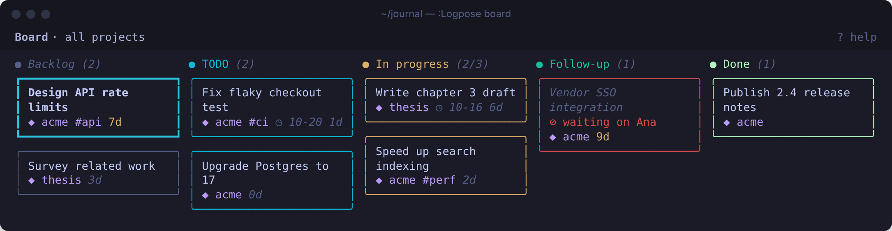
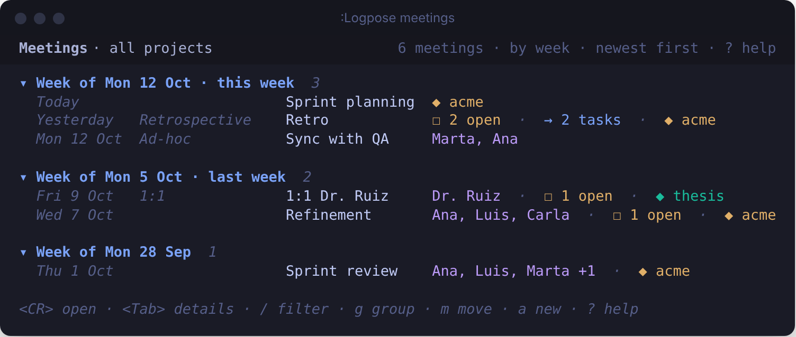
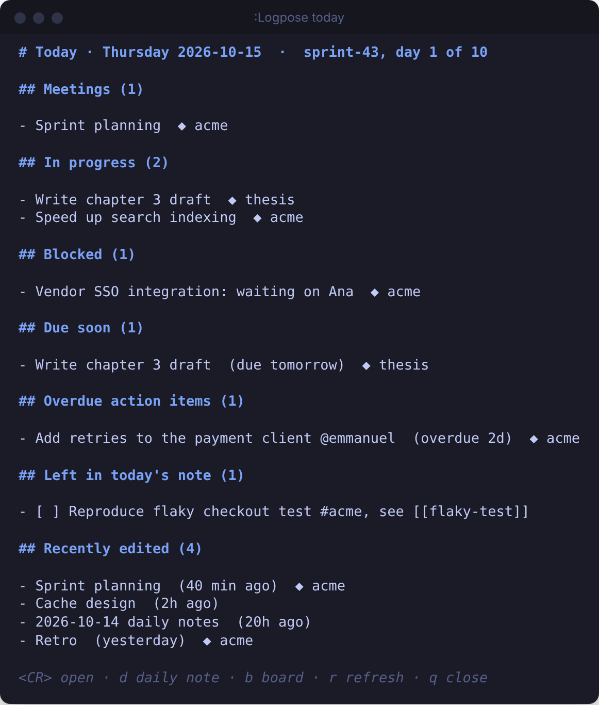
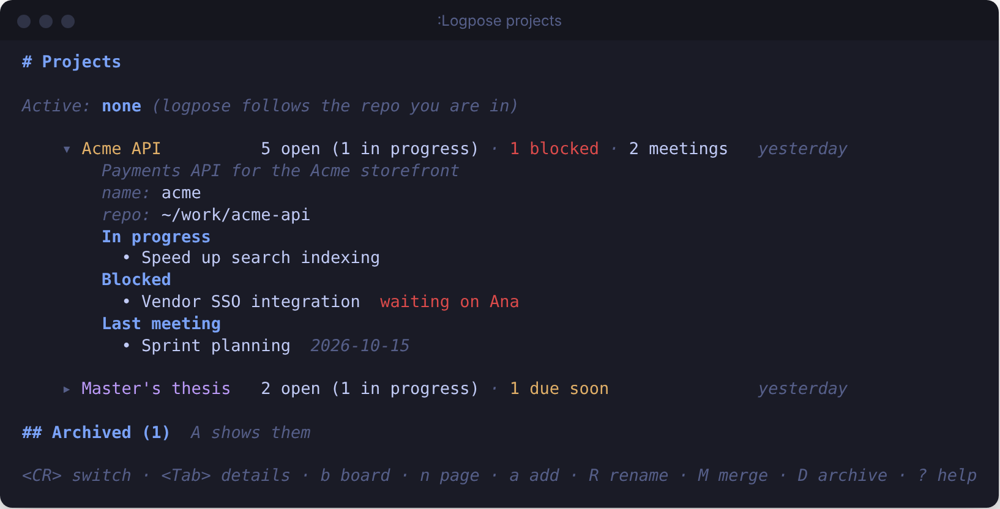
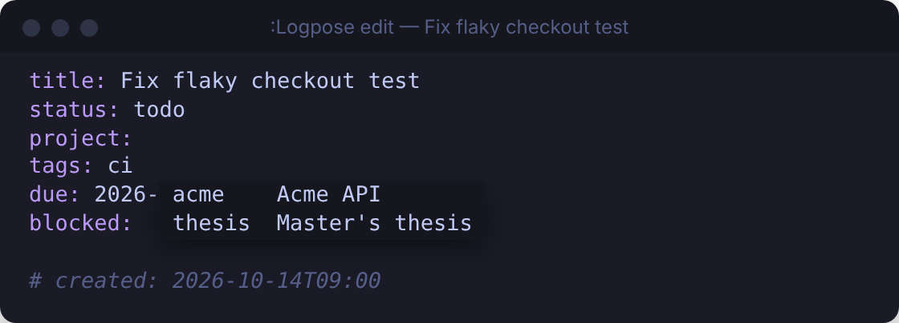

# logpose.nvim

**A sprint journal in Neovim.** Daily notes that prepare your standup, meeting notes that
remember last time's action items, and a Kanban board where every task is a markdown file.



- **Plain markdown, no database.** Everything lives in a folder you choose. logpose reads the
  structure you already write: frontmatter, `## headings`, `#tags`, `@people` and `[[links]]`.
- **Built for Scrum.** It knows your sprints, so archives, reports and search filters work
  sprint by sprint.
- **Built for juggling projects.** It detects the project from the git repo you're in, and
  keeps meetings, tasks and the board apart per project.

Requires Neovim 0.10 or later.

## Contents

- **Start:** [Install](#install) · [Quick start](#quick-start) ·
  [Tasks, notes and to-dos](#tasks-notes-and-to-dos) · [How it fits a sprint](#how-it-fits-a-sprint)
- **Guide:** [Daily notes and standup](#daily-notes-and-standup) · [Meetings](#meetings) ·
  [Tasks and the board](#tasks-and-the-board) · [Lists](#meetings-notes-and-people-lists) ·
  [Today screen](#the-today-screen) ·
  [Projects](#projects) · [Search](#search) · [Action items](#action-items-and-people) ·
  [People](#people) ·
  [Editing details](#editing-details) · [Links](#topic-notes-and-links) ·
  [Sprints and reports](#sprints-archives-and-reports) ·
  [Extras](#extras)
- **Reference:** [Commands](#commands) · [Board keys](#board-keys) ·
  [Search filters](#search-filters) · [Keymaps](#keymaps) · [Configuration](#configuration) ·
  [Templates](#templates) · [Journal layout](#journal-layout) ·
  [Troubleshooting](#troubleshooting) · [Development](#development)

## Install

With [lazy.nvim](https://github.com/folke/lazy.nvim) (LazyVim included):

```lua
{
  "edieguez/logpose",
  event = "VeryLazy", -- right after startup, so the keymaps are there before the first :Logpose
  cmd = "Logpose",
  ft = "markdown", -- enables `gx` on links and tickets, and `[[` completion, in journal notes
  opts = {
    keymaps = true, -- optional: a <leader>j… key set (see Keymaps)
  },
}
```

Optional, and used automatically when present:

| Plugin | What it adds |
|---|---|
| [snacks.nvim](https://github.com/folke/snacks.nvim), [fzf-lua](https://github.com/ibhagwan/fzf-lua) or [telescope.nvim](https://github.com/nvim-telescope/telescope.nvim) | Search with live results and a preview. Without one, logpose uses `vim.ui.select` and the quickfix list. |
| [blink.cmp](https://github.com/Saghen/blink.cmp) or [nvim-cmp](https://github.com/hrsh7th/nvim-cmp) | Completion of `[[` note links ([setup](#topic-notes-and-links)). |
| A Nerd Font | Nicer board glyphs with `board = { icons = "nerd" }`. |

## Quick start

1. **Create a journal.** Run `:Logpose init` and accept `~/journal` (or type another folder).
   logpose creates `daily/`, `meetings/` and `tasks/` and remembers the folder, so every command
   works from any buffer. Pointing it at a folder that already has notes only adds a `.logpose`
   marker file.
2. **Tell it about your sprints** (skip if you work in weeks). Give it the start date and number
   of any one sprint:

   ```lua
   opts = {
     period = { kind = "sprint", sprint = { anchor = "2026-10-15", first_number = 43 } },
   }
   ```

3. **Start your day.** Run `:Logpose daily`, then `:Logpose board`.

Not sure what a command is called? Run `:Logpose` on its own for a menu of every command, with
what it does and the key you mapped to it. `:checkhealth logpose` shows which journal, project
and sprint logpose sees.

## Tasks, notes and to-dos

logpose keeps three things apart, and every command, screen and search uses these words:

| | What it is | Where it lives | You work with it |
|---|---|---|---|
| **Task** | Work to get done, with a status, project, tags and due date. | A file in `tasks/`. | `:Logpose board`, `capture`, `done`, `find tasks` |
| **Note** | What you write down: daily notes, meeting notes, topic notes, project pages. | `daily/`, `meetings/`, `notes/`, `projects/` | `:Logpose notes`, `daily`, `meeting`, `note`, `find notes` |
| **To-do** | A checkbox (`- [ ]`) inside a note: a reminder, or a meeting's action item. | The note it's written in. | `:Logpose check`, `actions`, `find todos` |

`:Logpose promote` moves things up a level, and links both ends to each other:

- **A to-do becomes a task.** The task gets `From: [[the note]]`; the to-do keeps its text (so an
  action item keeps its owner and due date) and gains a `→ [[task]]` line under it. From then on
  they [stay in step](#a-to-do-and-its-task-stay-in-step).
- **A task's write-up becomes a note.** The note starts with `From: [[the task]]`; the task lists
  the note under `## Notes`.

The board shows how many notes are linked with each task (`✎ 2`); `n` opens them.

## How it fits a sprint

| When | Run | What you get |
|---|---|---|
| Start of the day | `:Logpose today` | Tasks in progress, blocked and due; today's meetings, to-dos and recent notes. |
| | `:Logpose daily` | Today's note, with yesterday's finished and unfinished items already in place. |
| Before the standup | `:Logpose standup` | Yesterday / Today / Blockers, grouped by project, ready to read out. |
| Something comes up | `:Logpose capture Fix flaky test #ci` | A task in Backlog, without leaving what you're doing. |
| During the day | `:Logpose board` | Move cards with `H`/`L`, finish them with `x`, block them with `b`. |
| In a meeting | `:Logpose meeting retro` | A retro note with the last retro's open action items carried over. |
| After a meeting | `:Logpose promote` | Turns the action item (a to-do) under the cursor into a task. |
| Sprint review | `:Logpose report sprint` | What got done, decisions, and what needs attention. |
| New sprint | `:Logpose archive` | Files away the last sprint's done tasks. |

---

## Daily notes and standup

**One note per workday, and a standup that writes itself.**

```vim
:Logpose daily          " today's note
:Logpose daily prev     " the previous workday's (also: next, or a date like 2026-10-14)
:Logpose standup        " Yesterday / Today / Blockers for the standup
```

When logpose creates today's note, it starts from your most recent note (Friday's on a
Monday):

- To-dos you checked off under `## Today` move to `## Yesterday`.
- Unfinished to-dos move to the new `## Today`. In the old note they're marked `- [>]`, so each
  to-do lives in one place.
- Existing notes are never rewritten; only that marker changes.

`:Logpose standup` combines the daily note with the board:

```markdown
# Standup 2026-10-15

## Yesterday

### acme

- Review Ana's PR on the cache layer #acme

## Today

### acme

- [ ] Reproduce flaky checkout test #acme
- [ ] Speed up search indexing #acme

## Blockers

### acme

- Vendor SSO integration: waiting on Ana #acme
```

Tasks finished since the previous workday go under Yesterday, tasks in progress under Today,
and blocked tasks (with the reason) under Blockers. Items are grouped by their project tag.

> **Configure:** rename the sections with
> `standup = { sections = { yesterday = "Ayer", today = "Hoy", blockers = "Bloqueos" } }`.

## Meetings

**Meeting notes from a template, linked from your daily note, with last time's open items
carried over.**

```vim
:Logpose meeting              " the new-meeting form: type, title, date, people, tags
:Logpose meeting retro        " or straight away, by type
:Logpose meeting 1on1         " asks who the 1:1 is with
:Logpose meeting adhoc 2026-10-14   " a date backfills a note
```

**The new-meeting form.** `:Logpose meeting` without a type opens a form with every field
filled in as far as it can be: the first type, today's date, the active project. Pick the type
(`<CR>`), and the title follows it (`Retro`); type another title to replace it. For a 1:1 the
title field is the person (completing people you've met), for an ad-hoc meeting its title.
`attendees` and `tags` complete names and tags you've used. Below the fields, a summary says what
saving will do before anything exists:

```text
saving will:
• create meetings/acme/2026-10-22 - retro.md
• link it from the daily note of Thu 22 Oct
• carry over 2 open to-dos from Retro (Thu 8 Oct)
• then open it to write
```

`<C-s>` creates the note, closes the form and puts you in the note where the template's cursor
goes. `q` closes the form without creating anything. `:Logpose meeting 2026-10-14` opens the
form for that day.

With a type on the command line, it skips the form:

| Type | Asks for | Title |
|---|---|---|
| `planning`, `refinement`, `review`, `retro` | nothing | fixed (`Sprint planning`, …) |
| `1on1` | the person, with completion | `1:1 Ana` |
| `adhoc` | a title, with completion of past titles | what you type |

Each note gets frontmatter (type, date, title, attendees, project, tags) and a link under
`## Meetings` in that day's daily note. Running the same command again on the same day opens
the existing note instead of making a second one.

**Series.** Meetings with the same type and title (or the same person, for 1:1s) form a series
within a project. A new note in a series starts with a `Previous: [[…]]` link and a
`## Carried over` section holding the previous note's open to-dos. In the old note, those
are marked `- [>]`.

> **Configure:** add your own types in `meeting_types`
> (`standup = { label = "Standup", title = "Standup" }`), remove one (`retro = false`), or set
> `ask_attendees = true` on a type. Turn off carrying with `series = { carry_over = false }`.

## Tasks and the board

**Every task is a markdown file, so it has room for context. The board is how you move them.**

```vim
:Logpose capture Fix flaky test #ci due:fri   " new task in Backlog, for the active project
:Logpose capture Write chapter 3 +thesis      " … or for another one
:Logpose board                                " the Kanban board
```

**To set everything up front**, run `:Logpose capture` without text (or press `a` on the board).
It opens the [edit form](#editing-details) for a new task: you type the title, then set
its column, project, tags, due date, blocker and a line of context, with the same completion and
checks. It starts from the active project (on the board: the column you're in, and the project
row with `s`), and saving creates it.

**One line, for speed:** `:Logpose capture <text>` goes to the active project unless the text
names one with `+name` (`+none` for no project). `due:` takes a date, `today`, `tomorrow`, a
weekday (`fri`) or `+3d`, and `<Tab>` completes `+projects`, `#tags` and `due:`. The message
after it says where the task went (`→ acme (this repo)`); if that's wrong, `:Logpose edit last`
fixes it.

The board has five columns: **Backlog → TODO → In progress → Follow-up → Done**. Each card
shows its title and, under it, `◆ project · due Tue ✎ 2 #tags`. The project is in its own colour,
picked from your colour scheme (or set with `color:` on its project page, `e` in
`:Logpose projects`), so you can tell projects apart at a glance. Tags are chips, on a soft
background, so they stand out in any colour scheme. The rest is in a quiet colour.

`✎ 2` counts the notes linked with the task: meeting notes, daily notes and other notes that
link to it, and notes it links to (like the `From:` link a promoted to-do gets). Press `n` on
the card to open them: one opens directly, several in the picker, newest first.

Colour is kept for what needs your attention:

- **Due dates** read as words: `due Tue`, `due 3 Nov`; `due today` and `due tomorrow` in yellow;
  `overdue 2d` in red.
- **Blocked** cards have a red left edge and the reason in red: `⊘ waiting on Ana`.
- **Untouched** cards (a week by default) fade and say for how long: `idle 9d`. A blocked card
  doesn't fade.
- **Done** cards are dimmed, with a `✓`.
- **The focused card** has a heavy border and a background.

On a board showing one project, cards leave the project out, since it's in the board's title.
When a card is narrow, the date stays whole, the project name gets shorter and tags are left
out. Each card's border is in its column's colour, so you see a card's state at a glance;
`board = { border = "project" }` tints borders with the project's colour instead, and
`border = "neutral"` makes them all one quiet colour.

In progress has a work-in-progress limit of 3: its header shows `(2/3)`, and the count turns red
above the limit.

### Working on the board

The essentials (the [full list](#board-keys) is in the reference, and `?` shows it on the
board; the top bar shows the everyday ones when it has room):

| Key | Does |
|---|---|
| `h` `j` `k` `l` | Move between cards and columns. The mouse works too. |
| `H` `L` | Move the card to the previous / next column. `1`–`9` jump to column N. |
| `x` | Done. |
| `b` | Block (asks for the reason) or unblock. |
| `a` | Add a card to this column, in the new-task form: title, project, tags, due date… |
| `K` | Peek: open the task in a floating window to read or edit it. |
| `n` | Open the notes linked with the task (the `✎ 2` on the card). |
| `N` | Make a note from the task's write-up ([copy or move it](#from-a-task-to-a-note)). |
| `e` | Edit the card's title, project, tags, due date… in a form, with completion. |
| `v` | Mark the card (`V` or `<Esc>` unmarks all). `H` `L`, `1`–`9`, `x`, `b`, `m` and `e` then act on every marked card at once. |
| `<CR>` | Open the task file. |
| `u` / `<C-r>` | Undo / redo the last board change, exactly, log lines included. |

In a project's repo, the board shows that project's tasks. `p` shows all projects, `P` switches to
another project, and `m` moves the focused card to another project. With one row per project
(`s`), `a` adds the card to the row you're in.

To fix several cards at once, mark them with `v` and press `e`. Fields the cards share start
filled in; the others start empty, meaning "leave each card as it is". In `tags`, `+urgent -ci`
adds and removes tags and keeps each card's others; `none` clears a project, due date or blocker.
The whole change is one `u`.

### What a task file looks like

You never edit `status` by hand: logpose moves it, records `started` and `done`, and appends a
line to `## Log` on every change.

```markdown
---
title: "Fix flaky checkout test"
status: in-progress
project: acme
tags: [ci]
due: 2026-10-20
blocked: waiting on ana
created: 2026-10-15T09:05
modified: 2026-10-16T15:02
started: 2026-10-16
done:
---
## Context

Fails on Mondays only; see [[meetings/acme/2026-10-14 - retro|Retro]].

## Log

- 2026-10-15 09:05: created in Backlog
- 2026-10-16 09:10: TODO → In progress
- 2026-10-16 15:02: blocked: waiting on ana
```

### Other ways in and out

| From | Do | Result |
|---|---|---|
| Anywhere | `:Logpose capture text #tag +project due:DATE` | A Backlog task for the active project, or the `+project` named (`capture!` opens it). |
| A to-do in a meeting or daily note | `:Logpose promote` | A Backlog task with a `From:` link back; the to-do keeps its text and gains a `→ [[task]]` line under it. |
| A task file | `:Logpose done` | The task moves to Done. |
| A task file (or a selection in it), or `N` on the board | `:Logpose promote` | A topic note from the task's write-up, linked both ways (see below). |

To-dos aren't tasks: `:Logpose check` checks one off (or a visual selection of them), and again
unchecks it. `:Logpose done` only works in a task file.

### A to-do and its task stay in step

Once a to-do is a task, finishing either one finishes the other:

- **The task done** (`x` on the board, `:Logpose done`, the form, or `status: done` saved by hand)
  checks its to-do, in every note where it is (a to-do carried to a newer note keeps its `→` line).
- **The to-do checked** (`:Logpose check`, or `[x]` saved by hand) moves the task to Done. If the
  task hasn't started yet (Backlog or TODO), logpose asks first; say no and it won't ask again
  for that task.
- **Reopening works the same way.** The task moved out of Done unchecks the to-do; the to-do
  unchecked moves the task back to the column it was in before Done.

Notes changed this way keep their `modified:` date. A note with unsaved changes is edited in its
buffer, for you to save. Board undo (`u`) puts the to-do back too. If a task is marked done
outside Neovim, its to-do still counts as done in `actions`, `find todos` and the today screen.

### From a task to a note

Sometimes what you wrote while working on a task is worth keeping as a note. In a task file,
`:Logpose promote` (or `N` on its card) opens the new-note form filled in from the task: title,
project and tags, plus `content`:

- `copy` (the default) puts the write-up in the note and keeps it in the task;
- `move` puts it in the note and leaves only the link in the task.

The write-up is the task's body without `## Log` (its history), its `## Notes` and its own
`From:` line; select lines first (`:'<,'>Logpose promote`) to take just those. The note starts
with `From: [[tasks/queue-design|Queue design]]`, and the task gets
`- [[notes/queue-design|Queue design]]` under `## Notes`, so its card counts it (`✎`). If a note
with that title exists, the write-up is added to its end. On a to-do inside a task,
`:Logpose promote` still makes a task of the to-do.

> **Configure:** columns, WIP limits, colours and glyphs are all in [`board`](#configuration).

## Meetings, notes and people lists

**The board is for tasks; these are for everything else.**



```vim
:Logpose meetings                       " every meeting, by week
:Logpose meetings attendees:ana         " the ones Ana attended
:Logpose notes                          " topic notes and project pages
:Logpose people                         " everyone you work with
```

Each is a list grouped under headings, newest or most relevant first, with what matters at a
glance:

| List | Each line | Group by (`g`) |
|---|---|---|
| **Meetings** | date, type, title, who was there, open action items (`☐ 2 open`), tasks it led to (`→ 1 task`) | week · type · project · series |
| **Notes** | date, title, open to-dos, linked tasks, project, tags | type · project · tag · month |
| **People** | name, role, how to reach them, when you last met, open to-dos they own | page · project · role · last met |

Notes lists topic notes and project pages; daily notes show up with `type:daily` in the filter
(and meetings with `type:meeting`). Like the board, each list shows the active project, or every
project when there's none.

**Moving an entry changes its note**, so the list and your files always agree. Grouped by
project, `m` moves a meeting to another project (its file moves to that project's folder, links
follow); grouped by type it changes the meeting's `type:`; by tag it swaps the note's tag; by role
or project it updates the person's page. `<` and `>` move to the previous or next group. Groups
that come from the note itself (week, month, when you last met) can't be moved to; `e` edits the
date instead.

| Key | Does |
|---|---|
| `<CR>` | Open it. On a heading, fold the group; on `… N more`, show the rest. |
| `<Tab>` | Details: the attendees, action items, linked tasks; for a person, their meetings, to-dos and mentions. `<CR>` opens any of them. |
| `K` | Peek: the note in a floating window, to read and edit. |
| `/` | The filter bar (below): the list follows as you type. `<BS>` clears the filter. |
| `g` / `s` | Change the grouping / the order (newest, oldest, by title; people: recently met, by name, most involved). |
| `m`, `<`, `>` | Move to another group (asks, with `new…` for a new project, tag or role) / the previous / the next. |
| `e` / `a` | Edit in the form / add a new one in the group you're in. |
| `p` | This project / all projects. |
| `z`, `]]`, `[[` | Fold the group; jump to the next / previous group. |
| `r` / `q` / `?` | Refresh / close / the keys and the filter cheat sheet. |

### The filter bar

`/` on a list or the board opens a one-line filter over it. What's behind it updates as you
type, and a menu shows what you can type next, each with a word on what it does: first the
filters (`type:`, `attendees:`, `date>=`, `or`, `not`, and the fields your notes use, like
`room:`), then their values from your journal (meeting types, projects, tags, people, dates
like `today` or `-7d`). `<Tab>` completes, `<CR>` keeps the filter, `<Esc>` puts the old one
back and `<F1>` shows the cheat sheet. The bar's lower edge counts what matches and names any
word it ignored (a half-typed `since:2026-1`, say). `?` on a list shows its keys and the same
cheat sheet; `:Logpose find` completes filter values on the command line too.

The people list adds `y` (copy a way to reach them), `o` (open it: mail, chat), `1` (start a 1:1)
and `R` (rename them everywhere); the notes list `d` (today's daily note) and `b` (the board).
When a bare first name (`ana`) is probably someone with a fuller name (`Ana López`), the people
list says `same as Ana López? R merges`, and `R` offers that name. You (`me`) aren't listed.
Rows leave out what their group heading already says (the project, the meeting type), and a
meeting whose title is its type shows it once.
`f` on a project in `:Logpose projects` opens its notes.

## The today screen

**Your day on one screen.**



`:Logpose today` has two parts. **Tasks**: what's in progress, blocked, and due within three days.
**Notes**: today's meetings, the to-dos left under Today in your daily note, overdue action
items, and the notes you edited lately (the last five from the past week, newest first). Press
`<CR>` on an item to open it. `d` opens the daily note, `b` the board, `r` refreshes and `q`
closes.

## Projects

**One journal, many projects, kept apart automatically.**

### Switching

`:Logpose project` (or `P` on the board) opens the projects screen below; `<CR>` on a project
switches to it. Switching brings back your board on that project (as you left it: filter, marks,
folded columns) and takes effect everywhere else at once. `projects = { open_board = false }`
switches without leaving where you are.

```vim
:Logpose project          " the projects screen
:Logpose project acme     " switch directly
:Logpose project none     " no project: pick one for each note as you create it (0 on the screen)
:Logpose project auto     " work it out from where you are (c on the projects screen)
```

**No project** suits switching contexts all day: nothing is pinned or detected, and new meetings
and topic notes open their form with the project empty, so you choose it there
(`:Logpose meeting retro` opens the form with Retro picked, `:Logpose note Title` with the
title). The board, today and the lists show every project. It stays that way, across
restarts, until you switch to a project or `auto`.

With `auto` (the default), logpose works the project out from where you are:

1. a match in `projects.paths` in your config;
2. a repo folder listed in a project's page (see below);
3. the git repo of the current file: `~/work/Acme API` becomes `acme-api`;
4. otherwise none. Inside the journal itself, there's no project.

With a project active:

- meeting notes go to `meetings/acme/` and their series stay within the project;
- captured tasks get `project: acme`;
- the board and the statusline show that project's tasks;
- daily-note links are prefixed: `- acme: [[…|Retro]]`.

### Managing projects

`:Logpose projects` shows every project with what needs attention: overdue, due-soon and blocked
tasks, work in progress, and how long ago anything happened. The most recently active projects
come first, and ones untouched for two weeks fade. `<Tab>` opens a project in place:



| Key | Does |
|---|---|
| `<CR>` | Switch to the project. On a line inside an expanded project, open that task or note. |
| `<Tab>` | Show or hide what's going on in the project. |
| `b` | Open the project's board. |
| `n` | Open its project page. |
| `t` / `o` | Search its open tasks / its open to-dos. |
| `f` | Open the notes list for it. |
| `a` | Add a project: its name, then its repo folder (suggested from where you came from). |
| `p` | Link another repo folder to the project. |
| `e` | Edit its name, description, repo folders and colour in a form. |
| `R` | Rename it everywhere: tasks, notes, tags, its meeting folder and page, and links. |
| `M` | Merge it into another project. |
| `D` / `U` | Archive it / restore it (`A` shows archived projects). |
| `c` | Go back to automatic detection. |
| `0` | No project: pick one per note. |

**The project page** (`projects/acme.md`) is where a project lives. Its frontmatter is what the
projects screen shows, and you can edit it by hand (or with `e` there):

```markdown
---
title: "Acme API"
project: acme
description: Payments API for the Acme storefront
paths: [~/work/acme-api, ~/work/acme-web]
color: "#e0af68"
---
```

- `title` is the name you see. `project` is the short name used in commands and files.
- `paths` are the repo folders that belong to the project. Working in one of them makes it the
  active project, with no config needed.
- `color` (a hex colour or a highlight group) colours the project's cards on the board.
- The rest of the page is yours: overview, links, decisions, open questions.

**Moving a task to another project:** `m` on the board, or change `project` in the edit form
(`:Logpose edit` in the task file). The move is logged in the task, and `u` on the board undoes it.

**Merging** (`M`, or `:Logpose merge-project old new`) moves everything from one project into
another: tasks, notes, meetings (files and series) and links. The old project page stays,
archived and marked `merged_into`, so links to it keep working. Like a rename, it shows every
change before applying it.

**Archiving** hides a project you're done with, without losing anything. Its tasks and notes
stay where they are and remain searchable, but it leaves completion, the projects screen and the
all-projects board. logpose records this as `archived: true` in the project page, and `U`
undoes it.

> **Configure:** `projects = { paths = { ["~/work/api"] = "acme" } }` also names a folder's
> project, from your config. `meeting_subdir = ""` keeps all meetings in one folder.

## Search

**Find anything in the journal, by text and by structure.**

```vim
:Logpose find                                  " all notes (not tasks)
:Logpose find tasks open #perf                 " open tasks tagged #perf
:Logpose find todos open @ana                  " unchecked to-dos involving Ana
:Logpose find decisions project:acme sprint:-1 " last sprint's decisions for acme
:Logpose find people                           " everyone, then everything about one person
:Logpose grep                                  " plain live grep in the journal
```

The first word is the **scope**: `notes` (default), `daily`, `meetings`, `topics`, `tasks`,
`todos`, `decisions`, `blockers`, `tags`, `projects` or `people`. Notes, tasks and to-dos are
separate scopes: `notes` never lists tasks. Everything after it is a
**filter**, and every filter must match. The most useful ones:

| Filter | Matches |
|---|---|
| `#perf` | items tagged `perf` |
| `project:acme` | items of a project |
| `@ana` | items involving Ana |
| `open` / `done` | tasks (in Done or not), to-dos (checked or not) |
| `blocked` | blocked tasks |
| `sprint:current`, `sprint:-1`, `since:-7d` | a time range |
| `attendees:ana`, `date>=-30d`, `role:lead` | any frontmatter field |
| `a or b`, `not a`, `-a`, `( … )`, `-( … )` | either, neither, grouping |
| any other word | must appear in the text |

All filters are in the [reference](#search-filters). On the board and the lists, `/` opens the
[filter bar](#the-filter-bar), which suggests filters and their values as you type, and `?`
shows a cheat sheet.

**Live search.** With snacks, fzf-lua or Telescope, the picker prompt holds the query: it starts
with what you typed on the command line, and results update as you edit it. Half-typed filters
such as `project:` are ignored until they're complete. Every result has a preview at its line.

**Decisions and blockers.** Every line under a `## Decisions`, `## Blockers`, `## Risks` or
`## Open questions` heading is searchable, tagged or not. That's what the `decisions` and
`blockers` scopes find.

> **Configure:** `search = { live = false }` gives fixed results that the picker fuzzy-filters
> instead. `retrieval.sections` sets which headings count.

## Action items and people

**Action items are to-dos in meeting notes, with an owner and a due date.**

```markdown
- [ ] Share load-test results @ana due:2026-10-21
```

```vim
:Logpose actions             " open action items from all meeting notes
:Logpose actions mine        " yours (set me = "@yourname"), plus unassigned ones
:Logpose actions overdue     " past their due date
:Logpose actions person:ana  " Ana's
```

They open in the quickfix list, soonest due first, with overdue items flagged. Filters work as
in `find`.

**People** come from meeting `attendees:`, 1:1s and `@mentions`, and from [people pages](#people).
`@ana` or `person:ana` filters any search.

## People

**A page per person you work with: who they are, how to reach them, and your notes about them.**

```vim
:Logpose people        " everyone: role, how to reach them, when you last met, their open to-dos
:Logpose person ana    " Ana's page (or the form to add her)
```

A person's page is `people/<name>.md`:

```markdown
---
name: Ana López
aliases: [Ana]
role: Backend lead
projects: [acme]
email: ana@acme.com
slack: ana.lopez
---

Prefers async reviews. Back from leave on the 21st.
```

`aliases` make "Ana", `@ana` and "Ana López" the same person everywhere: completion, filters
(`person:ana` finds the notes that say Ana López too), the people list. `projects` puts her
first in that project's meetings before you've met her there. Add a person from the people list
(`a`), with `:Logpose person`, or with `:Logpose edit` on their page; the form has a field for
each way to reach people.

**The people list** (`:Logpose people`, see [the lists](#meetings-notes-and-people-lists)) shows
people with a page, then the people your notes mention who have no page yet. `<Tab>` shows what
involves someone (their meetings, the open to-dos they own, tasks and notes mentioning them).
`<CR>` opens their page, or the form to add one. `e` edits it, `1` starts a 1:1, `y` copies a way
to reach them and `o` opens it (a mail, a chat). `R` renames them everywhere, and `/` filters with
any field: `role:lead`, `slack:*`, `project:acme`.

`gx` on an `@mention` or an attendee opens their page. `:Logpose rename-person ana Ana García`
renames someone everywhere: the page (the old name stays as an alias), attendees and `@mentions`.

**Ways to reach people are yours to define**, so moving to a company on another chat app is a
config change. Email is there by default; add what you use:

```lua
people = {
  contacts = {
    email = { label = "Email", open = "mailto:{value}", order = 1 },
    slack = { label = "Slack", show = "@{value}", order = 2,
              open = "slack://user?team=T012345&id={value}" },  -- optional: opens the chat
    phone = { label = "Phone", open = "tel:{value}", order = 3 },
  },
},
```

`show` is how the value is displayed and `open` what `o` opens; `{value}` is the page's value.
A key on a page that isn't configured still shows, under its own name.

**Suggesting people.** Wherever logpose asks for a person (the forms' `attendees`, a 1:1's
person, the attendees prompt, and in a note itself; see [completion in notes](#topic-notes-and-links)),
any part of the name or an alias matches and accents don't matter: `lop` finds Ana López, `jose`
finds José Ruiz. The note's project's people come first, then the people you meet most. Names
already in the list aren't offered again.

## Editing details

**Fix a task's project, a meeting's attendees or a due date without editing YAML.**

It works on tasks (title, status, project, tags, due, blocked) and on notes: meetings (title,
type, date, project, attendees, tags), topic notes (title, project, tags), project pages (title,
description, paths, colour) and people pages (name, aliases, role, projects, ways to reach them).
The form's title says which it is (`Edit task · …`, `Edit meeting · …`). Other keys are left as
they are.

`:Logpose edit` opens the frontmatter of the current task or note as a form. It also opens from `e` on a
board card, `e` on a project in `:Logpose projects`, and `:Logpose edit last` for the task you
just captured:



Each line holds one value, with the field's name beside it, so you only ever edit values:

- **As you type**, a menu offers what fits the field: your projects, the board's columns, tags
  you already use, people from your meetings, meeting types, and the next two weeks for dates.
  In `tags` and `attendees` (written `a, b`) it offers the next item.
- **Every value is checked as you type.** A problem shows beside the field
  (`✗ not a date: try today, fri, +3d`). A valid value gets a note: what a date means
  (`Fri 16 Oct · tomorrow`), a project's name, `new project`, or `new: Maria` for an attendee
  nobody has used yet (a new person, or a typo). An empty field shows what to type.
- **Below the fields**, a summary says what saving will do: move the task to In progress and
  set `started`, change the project (logged), or move a meeting note and fix the links to it.

| Key | Does |
|---|---|
| `<Tab>` | Open the menu (or go to the next field when there's nothing to complete). `<S-Tab>` goes back. |
| `<CR>` | In insert mode with the menu open, accept the highlighted item (or the best match for what you typed); otherwise go to the next field. In normal mode, pick a value from a list (status, project, type, tags…). |
| `<C-a>` `<C-x>` | Next / previous status, project or meeting type; a day later / earlier for dates. |
| `dd` | Clear the field. |
| `+` | Add a field the form doesn't show. |
| `<C-s>` or `:w` | Save. The form stays open, showing what was written, so you can keep editing. Nothing is saved while a field shows a problem. |
| `q` | Close (with unsaved changes, press it twice to discard them). `:wq` saves and closes. `?` shows these keys in the form. |

Saving does what logpose would do. A task's status, project and blocker go through the board's
code, so they're logged and `started`/`done` stay right, and `u` on the board undoes an edit made
there, one save at a time. Moving a meeting to another project moves the note into that project's folder, follows its
series, and fixes links to it, including the `- project:` label in your daily note. Renaming a
project is `R` in `:Logpose projects`, since that updates every note.

Several tasks at once: mark cards on the board with `v`, or select lines of a quickfix list of
tasks and run `:'<,'>Logpose edit` (see [Working on the board](#working-on-the-board)).

## Topic notes and links

**Notes that aren't tied to a day, and links between everything.**

| Command | Does |
|---|---|
| `:Logpose note Queue design` | Creates or opens `notes/queue-design.md`, for how-tos, decision records and references. A different title with the same file name (`C++ tips`, `C# tips`) gets its own file, `c-tips-2.md`. |
| `:Logpose note` | The new-note form: title, project and tags, then the note opens. |
| `:Logpose project-page` | Creates or opens `projects/<project>.md`, the hub for a project. |
| `:Logpose backlinks` | Notes linking to the current one. |
| `:Logpose links` | Links going out of it, with missing targets flagged. |

Wiki links (`[[target|label]]`, or a short `[[name]]`) and relative markdown links
(`[label](x.md)`, `[label](<my note.md>)`, `[label](x.md "title")`, `my%20note.md`) all work.
A wiki link's target is relative to the journal root (`link_base`), not to the note, and may
contain spaces: `[[meetings/acme/2026-10-14 - retro|Retro]]`. Code blocks are left out: a
`#include` or `[[x]]` inside ```` ``` ```` is code, not a tag or a link.

**Following links.** `gx` on a wiki link in a journal note opens the note it points to, from
anywhere on the link (the path or the label). Everything else goes to the `gx` you already have:
a markdown plugin's (such as markwright.nvim, which keeps following markdown links, anchors,
footnotes and URLs), or Neovim's, in which case logpose also opens markdown links to notes.
logpose sets its `gx` after other plugins have set theirs, so the order they load in doesn't
matter.

**Completion in notes.** In a journal note, typing `[[` offers every note and task to link;
in the frontmatter's `attendees:` and `with:` lines, typing a name (after `[` or a comma) offers
people; and `@` in the text offers people as `@handle`. It needs a completion plugin:

- **blink.cmp:** add `logpose = { name = "logpose", module = "logpose.completion.blink" }` to
  `sources.providers`, and `"logpose"` to your markdown sources.
- **nvim-cmp:** logpose registers the source itself; add `{ name = "logpose" }` to your markdown
  sources.

## Sprints, archives and reports

**logpose knows which sprint any date falls in.** Give it the start date and number of any one
sprint; the rest are counted in both directions:

```lua
period = {
  kind = "sprint",
  sprint = { anchor = "2026-10-15", length_days = 14, first_number = 43 },
},
```

This drives `sprint:` filters, the `{sprint}` template variable, the board's Done column (it
shows the current sprint), the statusline and the reports below. Without it, periods are
Monday-to-Sunday weeks.

**Reports.** `:Logpose report sprint` summarises the current sprint: tasks done, meetings,
decisions and open action items. A review section lists what needs attention: overdue action
items, old open to-dos, blocked tasks, and tasks in progress for too long.

```vim
:Logpose report sprint -1               " the previous sprint
:Logpose report sprint -1 project:acme  " just one project
:Logpose report! sprint -1              " save it to reports/sprint-42.md
```

**Archive.** `:Logpose archive` moves done tasks from past sprints into
`tasks/archive/sprint-42/`, where reports and search still find them. It shows a preview and
asks first, and running it twice is harmless.

## Extras

### Statusline

`require("logpose").statusline()` returns something like
`acme · 2 in progress · 1 blocked · sprint-43 2/10`. It's cached, so it's cheap to call on every
redraw. For lualine:

```lua
sections = {
  lualine_x = { function() return require("logpose").statusline() end },
}
```

Hide parts with `statusline({ project = false, tasks = false, period = false })`, or change the
`separator`.

### Tickets

With `tickets = { url = "https://acme.atlassian.net/browse/{id}" }`, `gx` on `PROJ-123` in a
journal note opens the ticket. `:Logpose ticket` lists every line mentioning the ticket under
the cursor.

### Saved views

Name the searches you run often:

```lua
views = { acme = "tasks open project:acme", decisions = "decisions sprint:current" },
```

Then `:Logpose view acme`, or `:Logpose view` to pick one.

### Renaming tags and projects

`:Logpose rename-tag perf performance` and `:Logpose rename-project acme acme-web` rename
everywhere: tags, frontmatter, meeting folders, project pages and links (short `[[acme]]` ones
too, when the name is unique). Code blocks are left alone. Both preview the changes and ask
first, and refuse while a file they'd touch has unsaved changes. Open buffers follow the files
they move.

### Usage stats

On by default, and they never leave your machine: logpose counts which commands you use per
day, in a file only you can read. It records command names only, never note content or paths,
and counts from several open Neovims add up. Turn them off with
`telemetry = { enabled = false }`. `:Logpose stats` shows the counts and the commands you
haven't tried. The `:Logpose` menu also uses them to list your most-used commands first.

---

## Commands

Every command is `:Logpose <name>`, with `<Tab>` completion, and has a `<Plug>(logpose-<name>)`
mapping. A `!` can go on either word: `:Logpose archive!` is the same as `:Logpose! archive`.

### Daily work

| Command | Does |
|---|---|
| `today` | The day at a glance: tasks, then notes. |
| `daily [today\|prev\|next\|DATE]` | Open (and create) a daily note. `prev`/`next` step by workday. |
| `standup [DATE]` | Yesterday / Today / Blockers in a scratch buffer. |
| `meeting [TYPE] [DATE]` | New meeting note. Without a type, the new-meeting form. |

### Tasks

| Command | Does |
|---|---|
| `board [FILTERS]` | The Kanban board. |
| `capture[!] [TEXT]` | New task in Backlog. Without text, the new-task form; with text, `+name` picks the project. `!` opens it. |
| `done` | Move the task you're in (its task file) to Done. |

### To-dos

| Command | Does |
|---|---|
| `check` | Check off the to-do on this line (or the selected ones); again to uncheck. |
| `promote` | On a to-do: a task, linked both ways. In a task file (or a selection): a note from its write-up, linked both ways. |
| `actions [open\|mine\|overdue\|all] [FILTERS]` | Meeting action items (to-dos in meeting notes) in the quickfix list. |

### Finding things

| Command | Does |
|---|---|
| `find [SCOPE] [FILTERS]` | Search the journal. |
| `grep [TEXT]` | Live grep in the journal. |
| `view [NAME]` | Run a saved search. |
| `ticket [ID]` | Every line mentioning a ticket. |
| `backlinks` / `links` | Links into / out of the current note. |

### Notes and projects

| Command | Does |
|---|---|
| `meetings [FILTERS]` | Every meeting, by week, type, project or series, with attendees and action items. |
| `notes [FILTERS]` | Topic notes and project pages by type, project, tag or month, with their to-dos and linked tasks. |
| `note [TITLE]` | Create or open a topic note. Without a title, the new-note form. |
| `project [NAME\|none\|auto]` | Switch project (the projects screen without a name); `none` for no project, `auto` to detect it. |
| `projects` | Manage projects: what needs attention, add, rename, merge, archive. |
| `project-page [NAME]` | Create or open a project page. |
| `people [FILTERS]` | Everyone you work with, how to reach them, what involves them. |
| `person [NAME]` | Open someone's page, or add one. |
| `edit [last]` | Edit the frontmatter of this note or task (or the last captured task's, or the tasks on selected quickfix lines) in a form. |

### Sprints and maintenance

| Command | Does |
|---|---|
| `report[!] [week\|sprint] [OFFSET] [FILTERS]` | Week or sprint summary. `!` saves it. |
| `archive[!]` | Move done tasks from past weeks or sprints to `tasks/archive/`. `!` skips the preview. |
| `rename-tag[!] OLD NEW` | Rename a tag everywhere. |
| `rename-project[!] OLD NEW` | Rename a project everywhere. |
| `merge-project[!] OLD NEW` | Merge one project into another. |
| `rename-person[!] HANDLE [NEW NAME]` | Rename a person everywhere (asks for the name if not given). |
| `init [DIR]` | Choose or create the journal folder. |
| `stats[!] [DAYS]` | Usage stats. `!` resets them. |

## Board keys

| Key | Action | Key | Action |
|---|---|---|---|
| `h` `l` | previous / next column | `j` `k` | previous / next card |
| `H` `L` (`<` `>`) | move the card left / right | `1`–`9` | move it to column N |
| `x` | done | `b` | block (asks why) / unblock |
| `<C-j>` `<C-k>` | move the card down / up | `a` | add a card to this column |
| `K` | peek in a floating window | `D` | delete the card (asks first) |
| `n` | notes linked with the task | `N` | a note from the task's write-up |
| `z` | fold / unfold the column | `gg` `G` | first / last card |
| `u` | undo | `<C-r>` | redo |
| `c` | compact one-line cards | `s` | one row per project |
| `<CR>` | open the task file | `/` | the [filter bar](#the-filter-bar); `<BS>` clears the filter |
| `p` | this project / all projects | `P` | projects screen (switch there) |
| `m` | move the card to another project | `e` | edit the card's fields |
| `v` | mark / unmark the card | `V` `<Esc>` | unmark all |
| `r` | refresh | `q` | close |
| `?` | the keys and the filter cheat sheet | | |

With cards marked, `H` `L`, `1`–`9`, `x`, `b`, `m` and `e` act on all of them as one undo step.

## Search filters

| Filter | Matches |
|---|---|
| `project:acme` | items of the project, or tagged `#acme` |
| `#perf`, `tag:perf` | tagged items |
| `@ana`, `person:ana` | items involving the person: attendee, 1:1, or @mention |
| `type:retro` | meetings of that type; `type:daily`, `type:meeting`, `type:topic`, `type:project`, `type:task`, `type:person` for kinds of notes |
| `open`, `done` | tasks (in Done or not) and to-dos (checked or not) |
| `status:in-progress` | tasks in that board column |
| `blocked` | blocked tasks |
| `since:DATE`, `until:DATE` | `2026-10-14`, `today`, `yesterday`, `tomorrow`, `-7d`, `+2w` |
| `week:current`, `sprint:-1`, `sprint:42` | a whole week or sprint |
| `section:decisions`, `section:follow-ups` | lines under a matching `##` heading |
| `key:value` | any frontmatter field containing the value (case and accents ignored): `room:lisboa`, `role:lead` |
| `attendees:ana`, `with:ana` | meetings with the person, by any of their names, or part of one |
| `date:2026-10`, `date:2026`, `due:today` | a day, month or year (also `created:`, `started:`, `done:`, `modified:`) |
| `date>=-7d`, `due<today`, `score>3` | comparisons: `>`, `>=`, `<`, `<=` (dates and numbers; outside date fields, `score>=2000` is a number, not a year) |
| `date:2026-10-01..2026-10-15`, `date:..2026-09` | a range of dates |
| `slack:*`, `has:email`, `no:email` | has the field / doesn't |
| `a or b` | either one (`and` is the default between filters; it binds tighter than `or`) |
| `not a`, `-a` | the opposite: `-#draft`, `not type:daily`, `-(type:daily or type:retro)` |
| `( … )` | grouping: `(type:retro or type:review) @ana` |
| `"two words"` | a value with spaces: `attendees:"Ana López"` |
| any other word | must appear in the text (accents ignored) |

Tags are inline `#words` (not headings, URL fragments, numbers like `#123` or anything in a
code block) and frontmatter `tags: [a, b]` or a `tags:` block list, compared without case.
Accented words count whole: `#reunión`, `@José`.

## Keymaps

logpose sets no keys unless you ask. `keymaps = true` installs this set under `<leader>j`
(choose another prefix with `keymaps = { prefix = "<leader>n" }`). It's labelled for which-key,
and it never replaces a key you've mapped yourself.

| | Key | Action | Key | Action |
|---|---|---|---|---|
| | `<leader>jj` | command menu | `<leader>jy` | today |
| | `<leader>js` | standup | `<leader>jr` | report |
| | `<leader>jP` | projects (switch, manage) | `<leader>je` | edit details (frontmatter) |
| | `<leader>ju` | people | | |
| **Notes** | `<leader>jl` | notes list | `<leader>jd` | daily note |
| | `<leader>jM` | meetings list | | |
| | `<leader>jm` | meeting note | `<leader>jn` | topic note |
| | `<leader>jf` | find notes | `<leader>jb` | backlinks |
| | `<leader>j/` | grep the journal | | |
| **Tasks** | `<leader>jk` | board | `<leader>jc` | new task |
| | `<leader>jX` | task done | `<leader>jt` | open tasks |
| **To-dos** | `<leader>jx` | check off (normal and visual) | `<leader>jp` | make it a task |
| | `<leader>jo` | open to-dos | `<leader>ja` | meeting action items |

To choose your own keys, map the `<Plug>` mappings instead:

```lua
vim.keymap.set("n", "<leader>jd", "<Plug>(logpose-daily)", { desc = "Daily note" })
vim.keymap.set("n", "<leader>jt", "<cmd>Logpose find tasks open<cr>", { desc = "Open tasks" })
```

## Configuration

`setup()` is optional: every command works with the defaults. These are the options you're most
likely to change:

```lua
require("logpose").setup({
  root = nil,              -- journal path; by default the one chosen with :Logpose init
  me = nil,                -- your handle in action items, e.g. "@ana"
  keymaps = false,         -- true for the <leader>j… set
  workdays = { 1, 2, 3, 4, 5 },   -- ISO weekdays, Monday = 1
  period = {
    kind = "week",         -- or "sprint"
    week_start = 1,        -- weeks start on Monday
    sprint = { anchor = nil, length_days = 14, first_number = 1, name = "sprint-{n}" },
  },
  projects = {
    detect = true,         -- the git repo you're in is the project
    paths = {},            -- { ["~/work/acme-api"] = "acme" }; the longest match wins
    open_board = true,     -- switching project opens its board
  },
  link_style = "wiki",     -- or "markdown"
  picker = "auto",         -- "snacks" | "fzf_lua" | "telescope" | "select"
})
```

Unknown options produce a warning and invalid values an error. Lists replace the default rather
than merging with it.

<details>
<summary><b>Board</b></summary>

```lua
board = {
  columns = {
    { key = "backlog", label = "Backlog" },
    { key = "todo", label = "TODO" },
    { key = "in-progress", label = "In progress", limit = 3 },  -- limit: WIP limit
    { key = "follow-up", label = "Follow-up" },
    { key = "done", label = "Done" },
    -- each column may also set hl = "<highlight group>" for its colour
  },
  start = "in-progress",   -- reaching this column records `started:`
  done = "done",           -- reaching this column records `done:`
  done_window = "period",  -- Done shows the current week or sprint, or a number of days
  min_column_width = 24,   -- below this width, columns stack vertically
  stale_days = 7,          -- cards untouched this long fade
  collapsed = {},          -- column keys folded when the board opens, e.g. { "done" }
  border = "column",       -- card borders in the column's colour; "project" or "neutral"
  icons = "unicode",       -- or "nerd" (Nerd Font) or "ascii"
  compact = false,         -- start with one-line cards (c toggles)
  lanes = false,           -- start with one row per project (s toggles)
  open = "window",         -- or "tab": open the board in its own tab page
},
tasks = {
  capture_status = "backlog",   -- column for :Logpose capture
  promote_status = "backlog",   -- column for :Logpose promote
},
```

Colours come from highlight groups linked to your colour scheme. Override
`LogposeBoardColumn1` to `LogposeBoardColumn5` (column headers), `LogposeBoardBorder`,
`LogposeBoardFocus`, `LogposeBoardFocusBg`, `LogposeBoardMeta` (card details),
`LogposeBoardNotes` (the linked-notes count),
`LogposeBoardBlocked`, `LogposeBoardOverdue`, `LogposeBoardDueSoon`, `LogposeBoardStale`,
`LogposeBoardDone`, `LogposeBoardMarked`, `LogposeBoardProject`, `LogposeBoardTag`,
`LogposeBoardTitle` or `LogposeBoardHint` to change them. The lists use `LogposeListHeading`,
`LogposeListGroup`, `LogposeListDate`, `LogposeListMeta`, `LogposeListTodos`, `LogposeListTasks`,
`LogposeListPeople` and `LogposeListHint`.

</details>

<details>
<summary><b>Notes, meetings and standup</b></summary>

```lua
meeting_filename = "{date} - {slug}",  -- add {time} (HHMM) to allow several per day
meeting_subdir = "{project}",          -- "" keeps all meetings in one folder
meeting_types = {
  planning   = { label = "Sprint planning", template = "planning", title = "Sprint planning", order = 10 },
  refinement = { label = "Refinement", template = "refinement", title = "Refinement", order = 20 },
  review     = { label = "Sprint review", template = "review", title = "Sprint review", order = 30 },
  retro      = { label = "Retrospective", template = "retro", title = "Retro", order = 40 },
  ["1on1"]   = { label = "1:1", template = "1on1", prompt = "Person: ", title = "1:1 {input}", person = true, order = 50 },
  adhoc      = { label = "Ad-hoc", template = "meeting", prompt = "Meeting title: ", order = 60 },
  -- a type may also set ask_attendees = true; set a type to false to remove it
},
series = { carry_over = true, mark_carried = true },
standup = {
  sections = { yesterday = "Yesterday", today = "Today", blockers = "Blockers" },
  carry_forward = true, mark_carried = true, group_by_project = true,
},
timestamps = { created = true, modified = true },  -- created:/modified: in frontmatter
```

</details>

<details>
<summary><b>Search, action items and reports</b></summary>

```lua
search = { live = true },              -- the picker prompt re-runs the query as you type
retrieval = { sections = { "decisions", "blockers", "risks", "open questions" } },
views = {},                            -- saved searches: name = "find arguments"
people = { contacts = { email = { label = "Email", open = "mailto:{value}", order = 1 } } },  -- see People
actions = {
  include_daily = false,               -- also collect to-dos from daily notes
  unassigned_mine = true,              -- items without an owner count as yours
  output = "quickfix",                 -- or "picker"
},
review = { stale_days = 14 },          -- old open to-dos, and tasks in progress too long, in reports
tickets = { pattern = "%u[%u%d]+%-%d+", url = nil },
telemetry = { enabled = true, retention_days = 180 },  -- local only; false to turn off
```

</details>

<details>
<summary><b>Folders and file names</b> (for an existing journal with its own layout)</summary>

```lua
root_markers = { ".logpose" },
dirs = {                               -- relative to the journal root
  daily = "daily", meetings = "meetings", notes = "notes", projects = "projects", tasks = "tasks",
  people = "people", templates = "templates", reports = "reports",
},
affixes = { daily = "daily-", week = "week-", sprint = "" },  -- week-/sprint folders in tasks/archive/
link_base = "",                        -- wiki-link targets are relative to this folder
```

For example, a journal kept in a subfolder of a repo:

```lua
opts = {
  root = "~/repos/notes",
  link_base = "journal",
  dirs = { daily = "journal/daily", meetings = "journal/meetings", templates = "journal/templates" },
}
```

logpose finds the journal in this order: `root`, then a `.logpose` marker above the current
file, then one above the current directory, then the journal chosen with `:Logpose init`.

</details>

## Templates

logpose ships templates for `daily`, `meeting`, `planning`, `refinement`, `review`, `retro`,
`1on1`, `note`, `project` and `task`. To change one, put a file with the same name in your
journal's `templates/` folder.

| Variable | Becomes |
|---|---|
| `{date}`, `{time}`, `{weekday}` | `2026-10-15`, `09:05`, `Thursday` |
| `{iso_week}`, `{sprint}` | `2026-W42`, `sprint-43` |
| `{title}`, `{type}`, `{type_label}` | the note's title and meeting type |
| `{project}`, `{series}`, `{attendees}` | from the active project and meeting |
| `{cursor}` | where the cursor lands (removed from the note) |

Unknown variables are left as they are.

**Timestamps.** New notes get `created:` and `modified:` in their frontmatter, e.g.
`2026-10-15T18:57`. `modified:` updates whenever logpose changes a note or you save one. Older
notes without the key are left alone; add it to opt one in.

**markdownlint.** Every note logpose creates passes markdownlint's default rules. Notes with a
`title:` in the frontmatter start at `##`, because markdownlint counts that title as the
document's heading (rule MD025). logpose keeps the blank lines markdownlint wants around the
headings, lists and code it inserts, and never rewraps your own text.

## Journal layout

```text
~/journal/
├── .logpose                         marks the journal root
├── daily/daily-2026-10-15.md        notes: daily, meetings, topics, project pages
├── meetings/
│   ├── acme-api/2026-10-14 - retro.md
│   └── 2026-10-13 - 1-1-ana.md      meetings outside any project
├── tasks/                           tasks: one file each
│   ├── fix-flaky-test.md
│   └── archive/sprint-42/           done tasks from past sprints
├── notes/queue-design.md            topic notes
├── projects/acme-api.md             project pages
├── people/ana-lopez.md              people pages
├── reports/sprint-42.md
└── templates/                       your template overrides
```

To-dos (checkboxes in notes): `- [ ]` open, `- [x]` checked, `- [>]` carried to a newer note.

## Troubleshooting

- **Start with `:checkhealth logpose`.** It shows the journal root and how it was found, the
  active project, the current week or sprint, which folders exist, the picker in use, and
  whether usage stats are on.
- **"Wrong project" or "no tasks on the board":** check the active project in the health report.
  `:Logpose project auto` unpins a project (or `none`), and `p` on the board shows all projects.
- **A file wasn't changed:** logpose never overwrites a file with unsaved changes. It edits the
  open buffer instead, or refuses and tells you. Writes are atomic: a failed save (a full disk)
  leaves the old file as it was, and a symlinked note is written through to its target.
- **"state.json couldn't be read":** logpose's saved state (the journal from `:Logpose init`,
  recent projects) was corrupt. It was moved to `state.json.bad` next to it, so nothing is lost;
  run `:Logpose init` again.
- **Search has no preview:** install one of the [optional pickers](#install).

## Development

```sh
make test                               # full suite (fetches mini.nvim into deps/ the first time)
make test-file FILE=tests/test_date.lua
make lint                               # stylua --check, and no accidental globals
make lint-md                            # markdownlint on templates and generated notes
make format
```

To check speed on a big journal, generate one and time the everyday operations:

```sh
python3 scripts/bench/gen_journal.py /tmp/journal --years 5
nvim --headless -u NONE -i NONE --cmd "set rtp^=$PWD" -l scripts/bench/bench.lua /tmp/journal
```

Tests use [mini.test](https://github.com/echasnovski/mini.nvim/blob/main/readmes/mini-test.md).
Each case runs in a fresh child Neovim, with `TZ=America/New_York` so date math crosses real
daylight-saving changes. The suite takes seconds. CI runs Neovim 0.10, stable and nightly.
`scripts/screenshots.sh` regenerates the images in this README from a demo journal.

The design and roadmap are in [`docs/SPEC.md`](docs/SPEC.md). Releases are tagged
`MAJOR.MINOR.PATCH`; `git tag -n` lists what each one added.

## License

Apache 2.0
